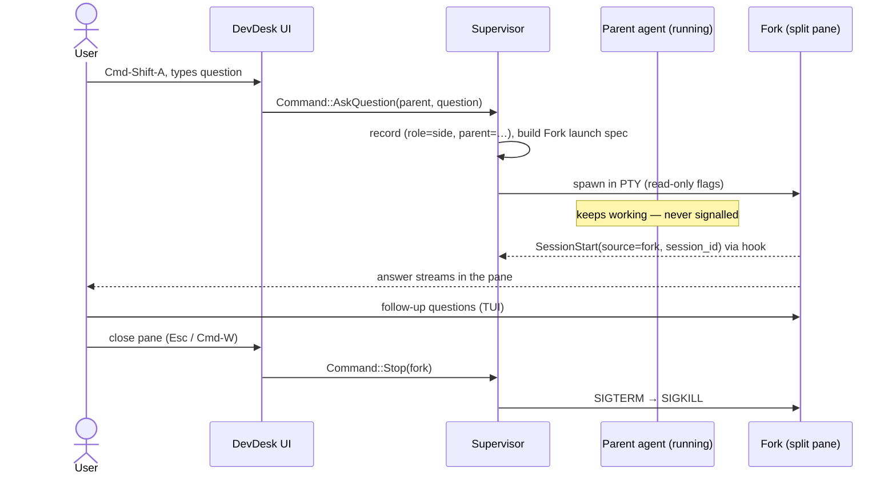

# DevDesk — Agent Integration

Status: **Proposed**. Evidence markers (✅ 🧪 📘 ❓) follow [technical-research.md](technical-research.md#how-to-read-this-document). Versions verified: Claude Code 2.1.295, codex-cli 0.161.0.

🧪 Replacement-machine M1 terminal startup fixtures cover Claude Code 2.1.295 and
codex-cli 0.162.0 (`codex --no-daemon`), without submitting a model prompt. These
are terminal protocol checks only. ❓ Re-run the full Appendix A fork/read-only
probes before relying on changed-version integration flags in M4–M6.

---

## 1. Integration strategy

**DevDesk runs the official agent CLIs as interactive TUIs inside its own terminal panes.** It adds metadata around them but implements no agent logic:

| DevDesk adds | Mechanism |
|---|---|
| Stable session identity | Claude: `--session-id` chosen by DevDesk. Codex: thread ID captured from `notify` |
| Status (working / idle / needs approval / exited) | Claude: hooks injected via `--settings`. Codex: `notify` + BEL + input observation |
| Resume | `claude --resume <id>` / `codex resume <id>` |
| Side conversations | Native fork (`--fork-session` / `codex fork`) in a split pane with enforced read-only flags |
| Lifecycle | The DevDesk supervisor owns the process (same as any terminal session) |

### Options evaluated

| Option | Verdict |
|---|---|
| **Interactive TUI in a PTY** | **Chosen.** Full fidelity, zero UI to rebuild, CLI updates arrive free |
| Structured subprocess output (`claude -p --output-format stream-json`, `codex exec --json`) | Not for primary agents (no interactive approvals or TUI features). **Kept as fallback approach B** for side conversations |
| Official SDKs | Claude: TS/Python only, **no Rust SDK** ✅. Codex: no SDK beyond app-server. Would need a Node or Python sidecar, so rejected |
| Codex app-server (JSON-RPC) | Richest status source ✅, but labelled **experimental** ✅. **Deferred**. A documented upgrade path for Codex status (§6.6) |
| Parsing transcripts / rollout files | **Rejected.** Claude's transcript format is documented as internal ✅. Codex rollouts are undocumented and mid-migration ✅ |

## 2. Provider architecture

A provider is a **pure** translator. It builds launch specs and interprets signals. It **never spawns, owns or kills processes**; the supervisor does that identically for every session. This keeps providers small, unit-testable (golden-argument tests), and free of concurrency.

```rust
// devdesk-core::agent (illustrative)

pub trait AgentProvider: Send + Sync {
    fn kind(&self) -> ProviderKind;                       // Claude | Codex
    fn capabilities(&self) -> Capabilities;
    fn check_installed(&self, env: &ChildEnv) -> Result<CliInfo, ProviderError>; // path + --version
    fn build_launch(&self, req: &LaunchRequest, ctx: &LaunchContext) -> Result<LaunchSpec, ProviderError>;
    fn interpret(&self, signal: &AgentSignal) -> Vec<AgentUpdate>;
}

pub struct Capabilities {
    pub assigns_session_id_up_front: bool,   // Claude yes, Codex no
    pub resume_by_id: bool,                  // both
    pub fork: bool,                          // both
    pub read_only_fork: ReadOnlyLevel,       // Claude: ToolRemoval, Codex: OsSandbox
    pub status: StatusFidelity,              // Claude: Hooks, Codex: NotifyAndBell
}

pub enum LaunchRequest {
    New { display_name: String },
    Resume { session_id: String },
    ResumePicker,                            // CLI's own picker, for sessions DevDesk didn't start
    Fork { parent_session_id: String, question: String },
}

/// Permission profile travels with EVERY launch, including Resume, ResumePicker and restore.
/// A record with role=Side can only ever be launched with ReadOnlySide (asserted in tests).
pub enum LaunchProfile { Primary, ReadOnlySide }

pub struct LaunchContext {
    pub profile: LaunchProfile,              // derived from AgentRecord.role, never from the UI
    pub agent_id: AgentId,                   // goes into DEVDESK_AGENT_ID
    pub launch_id: LaunchId,                 // DEVDESK_LAUNCH_ID: rejects stale signals
    pub hook_token: String,                  // DEVDESK_HOOK_TOKEN
    pub parent_model: Option<String>,        // passed to side forks (see §5.3)
    pub cwd: PathBuf,
    pub helper: PathBuf,                     // absolute path to the DevDesk binary (hook helper)
    pub parent_name: Option<String>,
    pub now: Timestamp,
}

pub struct LaunchSpec {
    pub program: String,                     // "claude" / "codex", resolved via login-shell PATH
    pub args: Vec<String>,                   // argv. Never a shell string
    pub env: Vec<(String, String)>,
    pub known_session_id: Option<String>,    // Claude: Some(uuid); Codex: None
}

pub enum AgentSignal {
    Hook(serde_json::Value),                 // from the hook helper (Claude hooks)
    Notify(serde_json::Value),               // from the hook helper (Codex notify)
    Bell,                                    // alacritty Event::Bell in this agent's pane
    InputSubmitted,                          // Enter pressed in this agent's pane
    Exited(Option<i32>),
}

pub enum AgentUpdate { Status(AgentStatus), SessionId(String) }
```

**Unsupported operations:**
- Capabilities drive the UI. A command that's unavailable (e.g. "Ask Question" on a Codex agent whose thread ID isn't known yet) is shown disabled with the reason.
- `build_launch` returns `ProviderError::Unsupported(op)` as a backstop.
- No provider pretends to support something.

**Why a trait now:** two real implementations exist in the MVP (Claude in M4, Codex in M6), so it is not speculative. A future Gemini CLI or OpenCode provider is one new file plus a config value. **What we don't build:** dynamic plugin loading, provider registries or capability negotiation protocols.

**One place builds argv.** Claude doesn't persist `--settings`, `--mcp-config`, etc. across resume ✅, so `build_launch` assembles the **complete** argument set for every New, Resume and Fork, from `(request, profile)`. Resuming a side conversation re-applies the full read-only flag set. Golden tests pin every `(request, profile)` combination, plus a test that a `Side` record can never produce `Primary` argv (including via restore and the picker).

**Providers propose; the state machine decides.** `interpret` is stateless: it maps a raw signal to a *candidate* event (e.g. "BEL seen"). The single `AgentStatus` machine in core applies candidates against the current state and the `LaunchId`.

## 3. Claude Code integration

### 3.1 Launch specs

All variants put **options before positional arguments**, and use `--flag=value` for variadic flags. 🧪 Variadic flags like `--allowedTools` swallow a following positional prompt.

| Request | argv (abbreviated) |
|---|---|
| New | `claude --session-id <uuid> --name "<display>" --settings <HOOKS_JSON>` |
| Resume | `claude --resume <uuid> --settings <HOOKS_JSON>` |
| Resume picker | `claude --resume --settings <HOOKS_JSON>` (the ID is learned from `SessionStart`, `source=resume`) |
| Fork (side) | see §5.3 |

Environment: `DEVDESK_AGENT_ID=<uuid>`, `CLAUDE_CODE_NONBLOCKING_STDOUT=1` ✅ (a stalled pane can never freeze Claude), standard terminal vars.

**User settings are respected.** DevDesk never modifies `~/.claude/settings.json` or project settings. Primary agents run with whatever permissions, model and MCP setup the user has.

### 3.2 Hooks for status

`HOOKS_JSON` (built once per launch; the helper path is absolute):

```json
{
  "hooks": {
    "SessionStart":      [{ "hooks": [{ "type": "command", "command": "'/Applications/DevDesk.app/Contents/MacOS/DevDesk' hook claude", "timeout": 5 }] }],
    "UserPromptSubmit":  [{ "hooks": [{ "type": "command", "command": "…same…", "timeout": 5 }] }],
    "PermissionRequest": [{ "hooks": [{ "type": "command", "command": "…same…", "timeout": 5 }] }],
    "PostToolUse":       [{ "hooks": [{ "type": "command", "command": "…same…", "timeout": 5 }] }],
    "Notification":      [{ "hooks": [{ "type": "command", "command": "…same…", "timeout": 5 }] }],
    "Stop":              [{ "hooks": [{ "type": "command", "command": "…same…", "timeout": 5 }] }],
    "SessionEnd":        [{ "hooks": [{ "type": "command", "command": "…same…", "timeout": 5 }] }]
  }
}
```

| Hook (✅ docs, 🧪 fired locally) | → AgentUpdate |
|---|---|
| `SessionStart` 🧪 (`source`: startup/resume/clear/compact/**fork** 🧪) | `SessionId(session_id)` + `Status(Idle)`. On `clear`, the session ID changes, so the record is updated |
| `UserPromptSubmit` 🧪 | `Working` |
| `PermissionRequest` ✅ | `NeedsApproval` |
| `PostToolUse` ✅ | `Working` (clears NeedsApproval after approval) |
| `Notification` ✅ `notification_type=permission_prompt` | `NeedsApproval` (backup for PermissionRequest) |
| `Notification` `idle_prompt` | `Idle` (backup; ~60 s lag) |
| `PostToolUseFailure` ✅ | `Working` (a denied or failed tool also ends NeedsApproval) |
| `PermissionDenied` ✅ | `Working` (auto-mode denial; manual denials use PostToolUseFailure) |
| `Stop` 🧪 | `Idle`. **But** another hook (e.g. the user's own) can block Stop and make Claude continue. A later `UserPromptSubmit`/`PostToolUse` puts it back to Working |
| `StopFailure` ✅ (API error ends the turn) | `Idle` with an error badge ("turn failed") |
| `SessionEnd` 🧪 | (informational; process exit is authoritative) |
| PTY child exit | `Exited(code)` |

Status is presented as **best-effort**. Before M4 sign-off, test these scenarios: approve then the tool fails, deny, API failure, parallel tool calls, and a user Stop hook that blocks.

`PostToolUse` and the tool failure/denial hooks clear NeedsApproval when a pending call finishes. `PreToolUse` would double the per-call helper cost and add no information. Per-call cost is measured in M4 (target under 10 ms per helper run).

**Hook helper contract** (critical: it must never slow down or break the agent):
1. Read the payload from **stdin for Claude hooks**, or from the **last argv argument for Codex `notify`** (Codex passes JSON as argv and gives null stdin ✅). Read `DEVDESK_AGENT_ID`, `DEVDESK_LAUNCH_ID` and `DEVDESK_HOOK_TOKEN` from env.
2. **Extract the small status fields first** (event name, session/thread ID, notification type), then send only those compact fields (at most 64 KiB); prompts, tool input/output and transcript paths are discarded. The stdin parser streams ignored fields, with a 200 ms read deadline and 64 MiB input ceiling, so a large ignored assistant message does not truncate a later session ID. Connect to `run/devdesk.sock` with a **200 ms connect and write deadline**. Write one line.
3. **Always exit 0 and print nothing to stdout**, even if DevDesk is unreachable. Claude parses hook stdout as JSON for some events, and exit 2 blocks. The helper must never do either.

The helper is the main binary, which dispatches on `argv[1] == "hook"` **before** initialising GPUI, so its startup cost is a plain Rust process start (≈ms). 🧪 M4 warmed release helper p95 is below 10 ms; first invocation exceeds it. Measurements are in [perf/m4.json](../perf/m4.json).

🧪 **A5 verified here:** Claude 2.1.295 ran both a temporary user-level Setup hook
and an injected `--settings` Setup hook with the same session ID. The probe uses
`CLAUDE_CONFIG_DIR` and `--init-only`; the real user's settings are untouched and
no model call is needed. This verifies settings merging; interactive event delivery
is part of owner acceptance. See [M4 review](m4-review.md).

✅ The documented [PermissionRequest payload](https://code.claude.com/docs/en/hooks#permissionrequest)
contains `tool_name`, but no `tool_use_id`. M4 matches by tool ID when present and
by tool name otherwise. Two simultaneous permission requests for the same tool
remain ambiguous. Tests cover distinct parallel tools with the documented shape.
✅ `stop_hook_active` identifies continuation from an earlier Stop hook; it cannot
prove whether another hook blocks the current Stop. Status remains best-effort,
with later tool events correcting it and PTY exit authoritative.

### 3.3 Sessions

- **Identity:** DevDesk generates the UUID and passes `--session-id`, so the record is complete before the process starts.
- **Discovery:** only DevDesk-launched sessions are listed (decision). For anything else, "Resume other Claude session…" runs `claude --resume` (the CLI's own picker) in a pane. When the user picks one, `SessionStart(source=resume)` reports its ID and DevDesk creates a record. Discovery works through a documented interface, with no file parsing.
- **The cwd invariant (correctness requirement, not a preference):** **Every Resume and Fork spawns with cwd = the record's stored `cwd`.**
  - 🧪 Resume *by ID* actually works from another directory in 2.1.295 (tested 2026-10-08: a fork launched from an unrelated directory succeeded).
  - But the resumed or forked agent's file tools, and `--restricted`'s confinement, apply to **its own cwd**. A side conversation launched elsewhere would read the wrong tree, or nothing.
  - Transcripts are stored per project directory ✅. The CLIs' resume and fork **pickers filter by cwd** (Claude ✅; Codex 📘, `--all` disables the filter).
- **Persistence:** CLI-owned. Claude writes the transcript incrementally 🧪, so a session killed by DevDesk's stop or quit is resumable up to its last flushed message.
- **Stop:** SIGTERM → process group, then SIGKILL after 3 s (architecture §6).

## 4. Codex integration

### 4.1 The daemon problem

By default the Codex TUI attaches to a **shared app-server daemon** ✅. When the TUI exits, "any running work continues" ✅. A DevDesk "Stop" or quit would kill only the TUI and leave the turn running in a daemon shared with the user's other Codex terminals. **Every Codex argv DevDesk builds contains `--no-daemon`.** The agent then runs inside the TUI process in DevDesk's PTY, the session still persists for resume, and DevDesk never touches the user's daemon (never `codex app-server daemon stop`).

### 4.2 Launch specs

Common flags (`CODEX_COMMON`):

```
--no-daemon
-c notify=["<helper>","hook","codex-notify"]
-c tui.notifications=["approval-requested"]
-c tui.notification_method="bel"
-c tui.notification_condition="always"
```

| Request | argv (abbreviated) |
|---|---|
| New | `codex CODEX_COMMON` |
| Resume | `codex resume <thread-id> CODEX_COMMON` |
| Resume picker | `codex resume CODEX_COMMON` |
| Fork (side) | see §5.4 |

Notes:
- `notify` replaces any `notify` the user configured in `~/.codex/config.toml`. DevDesk reads that documented config key and, if set, the helper **chains** to the user's original notify command after reporting, passing the **unchanged** JSON as the last argv argument, exactly as Codex would. ❓ Verify in M6.
- These `-c` overrides also force embedded mode ✅, which makes `--no-daemon` belt-and-braces.

### 4.3 Status

Codex hooks exist ✅, but hooks injected via `-c` are **untrusted and skipped** ✅. The only override is `--dangerously-bypass-hook-trust`, which also trusts every untrusted **repo** hook. **Rejected** (ADR-023). DevDesk combines three signals instead:

| Signal | Source | → AgentUpdate |
|---|---|---|
| `notify` payload, `type: agent-turn-complete` ✅ | helper → socket | `SessionId(thread-id)` (first time) + `Idle` |
| `Event::Bell` in the Codex pane | `tui.notifications=["approval-requested"]` with `method="bel"` ✅ | `Attention` (cleared by any input) |
| Enter pressed in the pane | DevDesk is the terminal | `ActiveInferred` (cleared by notify, or 10 min without PTY output) |
| PTY child exit | supervisor | `Exited(code)` |

Fidelity is **meaningfully lower** than Claude's, and the UI must say so rather than fake precision:
- BEL is an untyped byte ✅ and could come from a command the agent runs.
- Enter can also select a menu item, submit a slash command or dismiss a dialog, with no turn-complete ever following.
- Cancelled or failed turns may never send `notify`.

So Codex agents show **"Attention"** (BEL seen; cleared by any input in the pane) and **"Active (inferred)"** (input submitted; cleared by `notify` or after 10 minutes of no PTY output). They do not show Claude's precise Working/NeedsApproval.

Test before M6 sign-off: menus, Esc-cancel, a failed turn, and a command that prints BEL. **M6 includes a ½-day spike on the app-server path** (§6.6); if it's clean, it replaces these heuristics. ❓ A6.

### 4.4 Sessions

- **Identity:** no `--session-id` flag 📘. The thread ID arrives with the **first `notify`** (end of the first turn). Fallback: the exit summary (`codex resume <id>`) parsed from the pane on exit ✅. Before either arrives, the record has no provider ID: "Ask Question" is disabled and "Resume" uses the picker.
- **Discovery, persistence, stop:** same pattern as Claude. Stop sends SIGTERM to the process group, then SIGKILL. ❓ The Codex TUI may not handle SIGTERM gracefully; at worst the in-flight turn is lost. The conversation up to its last persisted item remains resumable.

### 4.5 Terminal compatibility requirements (both CLIs)

The embedded terminal **must**:
- Answer **CPR, DA1, OSC 10/11 colour queries and `ESC[?u`** (kitty keyboard query). Codex waits up to **250 ms** for these on every launch ✅. alacritty_terminal surfaces CPR/DA as `Event::PtyWrite` and OSC 10/11 as `Event::ColorRequest`, which DevDesk must write back.
- Encode keys with the **kitty keyboard protocol** when the app enables it (Shift+Enter in both CLIs ✅).
- Support bracketed paste, focus events (`?1004`), mouse reporting, alternate screen, OSC 8 hyperlinks and truecolor.

These are **M1 acceptance criteria**: `claude` and `codex` must start without a visible stall.

## 5. Contextual side conversations

### 5.1 Requirements recap

Ask about a running agent's work without interrupting it. The side conversation inherits context, a snapshot is acceptable, and read-only is **enforced by mechanism**.

### 5.2 Approaches evaluated

| | **A. Native fork** (recommended) | **B. Read-only question agent with selected context** (fallback) |
|---|---|---|
| Context | The **entire** parent conversation up to the fork moment, including reasoning visible in the transcript | Only what DevDesk can extract **through documented channels**: Claude's `Stop` hook `last_assistant_message` ✅, `git diff`, user-selected scrollback text |
| Mechanism | `claude --resume <id> --fork-session` 🧪 / `codex fork <id>` 🧪 | `claude --tools Read,Grep,Glob …` (fresh session) with an assembled context prompt |
| Parent interrupted? | **No** 🧪 (both CLIs: the parent finished its task normally while the fork ran) | No (independent) |
| Answers "why did you choose X?" | **Yes.** The fork sees the parent's actual reasoning | Poorly. It reconstructs reasons from code and the last message |
| Implementation cost | Small (argv + split pane) | Medium (context assembly, selection UI) |
| Cost per question | Re-sends the parent's full context (large on long sessions; prompt caching may soften this ❓) | Smaller context |

**Recommendation: A for the MVP.** Its whole value is "why did you decide…", and only the real conversation history can answer that. B stays documented as the fallback if read-only enforcement in **interactive** mode fails verification (A3/A4). In that case the side pane runs the fork headlessly (`claude -p --resume … --fork-session --output-format stream-json`, which is enforcement-verified 🧪) instead of as a TUI.

### 5.3 Claude side conversation

UX: in an agent pane, press **Cmd-Shift-A** (or choose "Ask Agent Question" in the palette). A one-line input appears for the question. DevDesk opens a **split pane** to the right and launches:

```
claude --resume <parent-session-id> --fork-session
       --settings <HOOKS_JSON>
       --restricted
       --strict-mcp-config
       --tools=Read,Grep,Glob
       --disallowedTools=Edit,Write,NotebookEdit,Bash,Agent,WebFetch,WebSearch,mcp__*,ShareOnboardingGuide
       --disable-slash-commands
       --permission-mode=dontAsk
       "<OBSERVER PREAMBLE + user's question>"
```

| Flag | Purpose | Evidence |
|---|---|---|
| `--tools=Read,Grep,Glob` | Only read/search built-in tools exist | 🧪 Edit/Write/Bash rejected, file unchanged |
| `--disallowedTools=…` | Belt-and-braces removal, including `Agent` (subagents) and `mcp__*` | 📘✅ |
| `--strict-mcp-config` | No MCP servers (some write externally) | 🧪 MCP tools present without it, gone with it |
| `--restricted` | Ignores user/project settings files (their permission allows don't apply), confines file tools to the working directory, refuses bypass | 📘✅ 🧪 (A4) |
| `--disable-slash-commands` | Removes skills (a residual tool in A4) | 📘 |
| `--permission-mode=dontAsk` | Anything that would prompt is denied, so the pane never waits on approvals | 📘✅ |
| `--settings` hooks | Status + **fork session ID** via `SessionStart(source=fork)` | 🧪 (A6, and under `--restricted` in A7) |

🧪 **This exact argv was run end to end (A7, `-p` mode):** it parses, `SessionStart(source=fork)` fires under `--restricted`, and write attempts fail with files unchanged. 🧪 Interactive TUI enforcement now passes in M5 (Claude 2.1.295); five synthetic forks inherited context, refused Write/Edit/Bash, and left the canaries unchanged while a two-minute parent task completed. See [M5 review](m5-review.md). The fork's cwd **must** be the parent record's cwd (§3.3).

**`--restricted` side effects:** it ignores user, project and local settings files. That includes their `env`, `model`, `apiKeyHelper` and third-party provider (Bedrock/Vertex) settings, not just permissions. This user authenticates with OAuth, which works (🧪 A4/A7). For other setups, the fork could use a different model or fail to authenticate. Mitigations:
- pass `--model <parent's model>` when known (from the `SessionStart` payload or the record);
- if auth fails in a side conversation, show "side conversations need OAuth or `ANTHROPIC_API_KEY`" instead of a raw error.

**Account tools:** 🧪 M5 interactive argv accepts an explicit `ShareOnboardingGuide` entry in `--disallowedTools`; production forks now always include it. 📘 The named deny flag removes that tool, while `--disable-slash-commands` removes Skill and strict MCP excludes external servers. No account tool was invoked. ❓ The interactive tool registry cannot be independently enumerated through a documented CLI interface; model self-reports are not proof that all future account tools are absent.

🧪 DevDesk persists the question as its sidebar display name, parent identity and snapshot time. It does not rename the parent's CLI conversation. Side history restores closed; Resume targets its captured fork ID and reapplies every read-only flag. M4 records remain compatible through defaulted JSON fields. ❓ The current documented hook projection does not capture the parent's model, so model inheritance cannot be guaranteed under `--restricted`. OAuth is verified here; other provider/auth configurations remain untested.

### 5.4 Codex side conversation

```
codex fork <parent-thread-id> --no-daemon -s read-only -a never
      -c mcp_servers.<name>.enabled=false        # one per server in the user's ~/.codex/config.toml
      --disable plugins --disable apps --disable computer_use --disable browser_use
      --disable browser_use_external --disable in_app_browser --disable image_generation
      -c notify=[…] -c tui.notifications=["approval-requested"] -c tui.notification_method="bel" -c tui.notification_condition="always"
      "<OBSERVER PREAMBLE + user's question>"
```

- **`-s` sandboxes only model-generated shell commands** 📘. MCP servers and plugins are separate processes and integrations **outside** that sandbox.
  - 🧪 (test C1): this user's config enables `node_repl` (runs JavaScript), `computer-use`, `solo`, `youtrack`, `vault_mcp` and several plugins. In a fork with only `sandbox_mode="read-only"`, `mcp__node_repl__js` was **available**. The model declined to use it, but that is prompt behaviour, not enforcement.
  - 🧪 (test C2): with every configured server disabled via `-c mcp_servers.<name>.enabled=false` plus the `--disable` features above, the fork's tool registry showed **no `mcp__*` tools**.
  - DevDesk enumerates server names from the user's `~/.codex/config.toml` (and the project's `.codex/config.toml`) at launch time. If the config can't be parsed, the side conversation **refuses to start**: fail closed.
- Remaining tools after C2: `exec_command`/`write_stdin` (sandboxed shell), `apply_patch` (🧪 C3: **rejected** under read-only + `approval_policy="never"`: `patch rejected: writing is blocked by read-only sandbox`), `web__run` (web search, read-only), `collaboration.*` (subagent tools; with `--no-daemon` the fork is a separate process and can't reach the parent's threads ❓, test in M6), `view_image`, goals.
- `-s read-only` → macOS Seatbelt. Shell writes fail at the OS level 🧪 (`touch: Operation not permitted`). Network is off for shell commands ✅.
- `-a never` → no approval prompts; failures go back to the model 📘.
- `--no-daemon` → the fork lives in DevDesk's PTY, so closing the pane really stops it. Without it, `-s`/`-a` do not force embedded mode ✅, and the fork would join the shared daemon.
- **Asymmetry (accepted):** Codex's read-only sandbox still allows *reading* shell commands (`git diff`, `git log`) 🧪. Claude's side conversation has no shell. Making Claude Bash read-only needs sandbox + allowlist work that isn't verified (see open-questions).

### 5.5 The observer preamble (accuracy, not security)

Both CLIs show the parent's **in-flight tool call as stopped** in the fork 🧪 (Claude: "the sleep was stopped"; Codex: `<turn_aborted>` ✅, and it even tried to poll the parent's process). Without guidance, the side agent will tell the user the main agent has stopped.

The preamble is sent as part of the **first user message**, not via `--append-system-prompt`. With `--system-prompt-snapshot` on (the default ✅), a resumed conversation replays its *recorded* system prompt, so appended system text on a fork may be ignored ❓.

> You are answering side questions about the session above. That original session is **still running in another window**; you are a read-only observer working from a snapshot taken at {time}. Any tool call that appears interrupted or aborted at the end of the history is still in progress in the original session — do not describe it as stopped, and do not try to continue, retry, or interact with its work or processes. Do not attempt to modify files. Files on disk may be mid-edit by the original session. Question: {question}

This improves answer accuracy. **Security comes only from the flags.** If the model ignores the preamble, it still cannot write.

### 5.6 What context the fork has

| Question from the brief | Answer |
|---|---|
| Can sessions be forked programmatically? | **Yes**, both CLIs 🧪 |
| Can a *running* session be forked safely? | **Yes** 🧪. Separate session/thread ID, separate file, no lock errors, parent unaffected |
| How are session IDs obtained? | Claude: DevDesk assigns them (`--session-id`); fork IDs via `SessionStart(source=fork)` 🧪. Codex: `notify` `thread-id` ✅ |
| Does the parent continue uninterrupted? | **Yes** 🧪 (both finished their task normally during the fork) |
| What context is in the fork? | Everything the parent had **persisted** at fork time. A turn still streaming may be partly missing ❓. In-flight tool calls appear aborted 🧪 |
| How do snapshots behave? | **Point-in-time copy.** Later parent progress is invisible. To refresh, ask again (a new fork) |
| Can the fork be read-only? | **Yes, enforced**: Claude by tool removal 🧪, Codex by Seatbelt 🧪. Interactive-mode verification pending ❓ (A3/A4) |
| Can it see current project state? | **Yes, read-only.** It reads files as they are on disk now, which may include the parent's half-finished edits |

### 5.7 Side conversation lifecycle



Side conversations are listed under their parent and can be resumed (same read-only flags), but are **not** restored as open tabs on relaunch.

## 6. Failure handling

| Failure | Detection | Behaviour |
|---|---|---|
| CLI not installed / not on login-shell PATH | `check_installed` at first use | Agent actions are disabled, with "claude not found on PATH (login shell)" |
| CLI older than the supported minimum | `--version` parse | Warning banner. Launch still allowed (flags may fail) |
| Resume target missing (deleted, other machine) | Process exits quickly with an error in the pane | Record marked `unresumable`; the pane output stays visible |
| Hook helper can't reach DevDesk | Helper connect timeout | Helper exits 0 silently. The agent is unaffected; status may go stale |
| Status stale (missed hook) | — | Process exit is always authoritative. Any later hook corrects the state |
| Fork requested before Codex thread ID known | Capability check | "Ask Question" disabled with the reason |
| Fork flags rejected by a future CLI | Fork exits non-zero within 2 s | Error shown in the pane. `scripts/cli-probe.sh` is the early warning |
| Agent hangs on SIGTERM | Escalation timer | SIGKILL after 3 s |
| Codex user `notify` config overridden | Startup read of `~/.codex/config.toml` `notify` | Helper chains to it |

### 6.6 Upgrade paths (not MVP)

- **Codex status via app-server:** DevDesk runs its own `codex app-server --listen unix://<app-support>/codex.sock`, launches TUIs with `--remote unix://…`, and subscribes to `thread/status/changed` (`waitingOnApproval`, `waitingOnUserInput`) ✅. Adopt once the protocol loses its experimental label, or if the BEL heuristic proves unreliable.
- **Agents that outlive DevDesk:** Claude's `--bg` / `claude agents` supervisor ✅ (research preview) could host primary agents, with DevDesk attaching via `claude attach`. Revisit only if the "stop on quit" decision changes.

## 7. Limitations and risks

| # | Risk | Likelihood | Impact | Mitigation |
|---|---|---|---|---|
| R1 | CLI flags or hook payloads change (both ship near-weekly) | High | Medium | Golden argv tests, `scripts/cli-probe.sh` on every CLI update, a minimum-version check |
| R2 | Interactive-mode read-only enforcement differs from `-p` | Low | High | First acceptance test of M5/M6. Fall back to headless fork (approach A-headless) |
| R3 | Fork misreports parent state | High (verified) | Low | Observer preamble. The UI labels the pane "snapshot at HH:MM" |
| R4 | Fork cost on long sessions (full context re-sent) | Medium | Low–Medium | Show the parent's context size, if exposed ❓. User awareness |
| R5 | Codex BEL heuristic gives false "needs approval" | Medium | Low | Accept; upgrade path via app-server |
| R6 | `--settings` hooks replace the user's hooks | Low | Medium | M4 probe (A5) |
| R7 | Claude `--bg` or Codex daemon defaults change further | Medium | Medium | `--no-daemon` is explicit. Probe script checks that stop really stops |
| R8 | Hook helper latency slows agents | Low | Medium | 200 ms connect timeout, minimal helper, measured in M4 |
| R9 | Account-level tools in read-only forks | Mitigated; future tools ❓ | Low (no project writes) | 🧪 M5 explicitly disallows `ShareOnboardingGuide`; no account action invoked |
| R10 | **Codex MCP servers and plugins bypass the shell sandbox** in side conversations | Verified (C1) | **High** | Disable every configured server + action features (C2). Fail closed if config is unreadable. Re-check when the user adds MCP servers |
| R11 | A side record resumed with primary (writable) flags | Low | High | `LaunchProfile` derived from the record's role. Golden tests for every path |
| R12 | Stale hook/notify from a previous instance | Medium | Low | `LaunchId` generation check |
