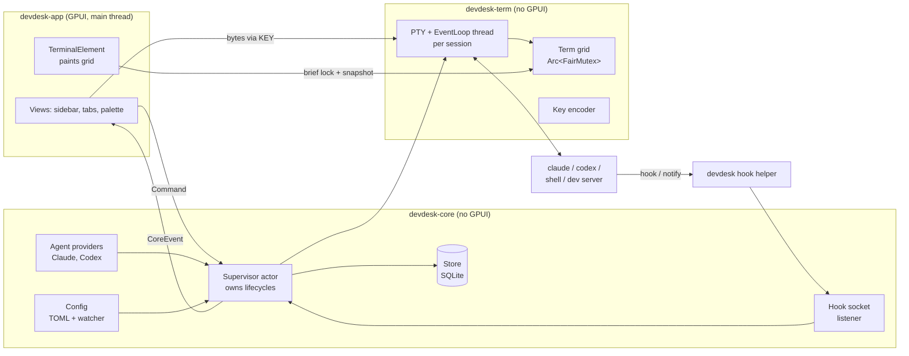
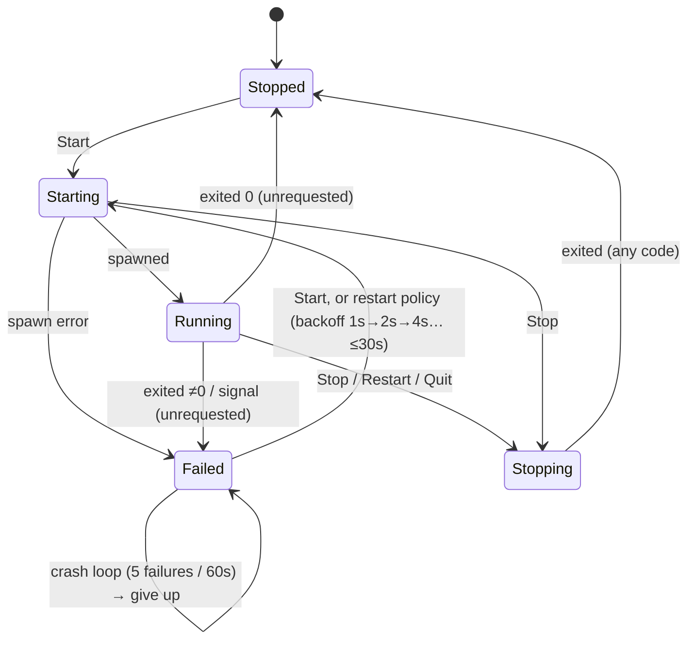
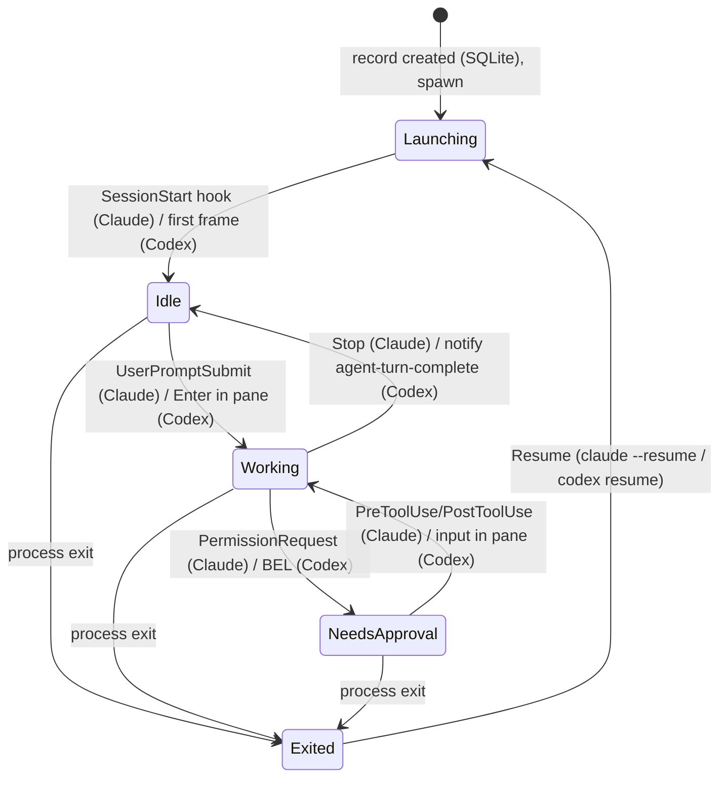

# DevDesk — Architecture

Status: **Proposed** (awaiting approval). Companion documents: [technical-research.md](technical-research.md) (evidence), [decisions.md](decisions.md) (ADRs), [agent-integration.md](agent-integration.md), [implementation-plan.md](implementation-plan.md), [open-questions.md](open-questions.md).

---

## 1. System overview

DevDesk is a native macOS app (Rust + GPUI) that hosts **terminal sessions** for three purposes:

1. **Shells.** Ad-hoc terminals the user opens.
2. **Processes.** Long-running dev commands defined in config (`php artisan serve`, `npm run dev`, …).
3. **Agents.** `claude` and `codex` TUIs, including read-only **side conversations** forked from a running agent.

**All three are the same thing underneath:** a child process in a PTY, rendered by one terminal component. They differ only in what DevDesk does around the PTY: lifecycle policy for processes, launch arguments and status signals for agents. Recognising this is the main simplification in the design. One terminal engine, one supervisor, three thin policies.

DevDesk **owns** every child process. When DevDesk quits, everything stops gracefully (after confirmation). Agent conversations survive anyway, because the CLIs persist them and DevDesk can resume them.



## 2. Architectural principles

1. **One terminal engine.** Shells, processes and agents share PTY, emulation, rendering and kill logic. Policy differs; mechanism doesn't.
2. **The core is plain synchronous Rust.** Threads and channels, no async runtime, no GPUI. It is testable with `cargo test` and no window.
3. **The UI is a projection.** GPUI views hold a *mirror* of core state, built from events. The UI sends commands and never blocks waiting for answers. Lifecycle decisions (signals, timeouts, restarts) are made only in the core.
4. **Agents are integrated through their public CLIs only.** We use documented flags, hooks and notify. We never parse transcripts or rollout files and never depend on internal storage.
5. **Enforce with mechanisms, not prompts.** Read-only side conversations are enforced by CLI tool removal (Claude) and the OS sandbox (Codex). Prompt text only improves accuracy.
6. **Bounded data.** Scrollback, hook payloads, IPC connections and history are capped. The only unbounded channel is the low-volume core→UI event channel (state transitions, never output). Idle means no timers, no polling, no redraws.
7. **Pin and contain churn.** GPUI and alacritty_terminal versions are pinned exactly. GPUI types never leave `devdesk-app`.
8. **No speculative infrastructure.** No daemon, plugin system, generic event bus or async runtime until a requirement forces one. Each has a documented trigger (see [decisions.md](decisions.md)).

## 3. Workspace structure

The brief suggested 7 crates. For a one-developer early-stage project that fragments the code: every cross-crate change means editing several `Cargo.toml` files and APIs, and the boundaries that matter can be enforced with fewer crates. **Recommendation: 3 crates.** Modules inside them give the remaining separation. A module can be promoted to a crate later if compile times or reuse demand it.

```
devdesk/
├── Cargo.toml                 # [workspace], shared lints, exact version pins
├── Cargo.lock                 # committed
├── deny.toml                  # cargo-deny: license allowlist (MIT/Apache/BSD/CC0/Zlib/Unicode)
├── crates/
│   ├── devdesk-term/          # Terminal engine. Depends on: alacritty_terminal, libc
│   │   └── src/{lib, pty, term, keys, snapshot, kill}.rs
│   ├── devdesk-core/          # Domain + lifecycle. Depends on: devdesk-term, rusqlite, toml, notify, serde
│   │   └── src/{lib, model, config, store, env, supervisor, process, agent/{mod, claude, codex, status}, ipc}.rs
│   └── devdesk-app/           # GPUI binary. Depends on: devdesk-core, devdesk-term, gpui-component (→ gpui-pre)
│       └── src/{main, app, views/{sidebar, workspace, tabs, palette, terminal_view}, terminal_element, theme}.rs
├── scripts/
│   ├── cli-probe.sh           # re-runs the agent CLI verification probes
│   └── perf/                  # startup, throughput, memory, idle-CPU harnesses
├── assets/                    # fonts, icons
└── docs/
```

### Dependency rules (enforced by Cargo)

```mermaid
flowchart TD
    app[devdesk-app<br/>GPUI] --> core[devdesk-core]
    app --> term[devdesk-term]
    core --> term
    term --> alac[alacritty_terminal]
    app --> gpui[gpui-component / gpui-pre]
    core -.x.-> gpui
    term -.x.-> gpui
```

- `devdesk-term` knows nothing about projects, processes or agents.
- `devdesk-core` knows nothing about GPUI. Agent providers live here and are pure (they build launch specs and interpret signals).
- `devdesk-app` contains no lifecycle logic. If a view module ever contains `kill`, `Duration` timeouts or restart counters, the design has been violated.

### Responsibilities

| Component | Owns | Does not own |
|---|---|---|
| `term::pty` | Spawning a program in a PTY (via alacritty `tty`), the EventLoop thread, resize, write | What the program *is* |
| `term::term` | `Arc<FairMutex<Term>>`, scrollback cap, event proxy (dirty flag + event forwarding), answering terminal queries (PtyWrite, ColorRequest) | Painting |
| `term::keys` | GPUI-free `KeyInput` → bytes, including kitty keyboard protocol, app-cursor mode and bracketed paste | GPUI keystroke types (the app converts those) |
| `term::snapshot` | Copying the visible region into a `RenderSnapshot` (styled runs + background rects + cursor) **under a short lock** | Fonts, shaping |
| `term::kill` | `killpg`, foreground-group lookup (`tcgetpgrp`), session sweep, escalation helpers | When to kill |
| `core::model` | `ProjectId`, `ProcessSpec`, `AgentRecord`, `SessionId`, status enums | — |
| `core::config` | TOML schema, validation, `toml_edit` writes (add project), file watcher | Runtime state |
| `core::store` | SQLite schema and migrations, agent records, UI layout blob, session ledger | Domain decisions |
| `core::env` | Resolving the login-shell environment once, caching it, building child environments | — |
| `core::supervisor` | **The** owner of every running session: start/stop/restart, state machines, timers, restart policy, shutdown, orphan recovery | Rendering |
| `core::process` | ProcessSpec → spawn spec, process status machine, restart backoff | Spawning (supervisor does it) |
| `core::agent` | `AgentProvider` trait, Claude and Codex implementations, agent status machine | Spawning |
| `core::ipc` | Unix socket listener for hook/notify messages | Interpreting them (providers do) |
| `app::*` | Window, views, focus, keybindings, palette, `TerminalElement` (shaping + painting snapshots), UI mirror of core state | Lifecycles |

## 4. Core domain model

```rust
// devdesk-core::model (illustrative; not final API)

pub struct ProjectId(pub String);          // slug from config, e.g. "billi"
pub struct SessionId(pub u64);             // DevDesk-local, monotonic per app run
pub struct AgentId(pub uuid::Uuid);        // DevDesk's stable ID for an agent record

pub struct Project {
    pub id: ProjectId,
    pub name: String,
    pub path: PathBuf,
    pub processes: Vec<ProcessSpec>,
    pub terminals: Vec<TerminalSpec>,      // saved terminal presets
    pub agent_defaults: AgentDefaults,
}

pub struct ProcessSpec {
    pub id: String,                        // "horizon"
    pub name: String,                      // "Horizon"
    pub command: String,                   // shell string, run via `$SHELL -lc`
    pub cwd: Option<PathBuf>,              // relative to project path
    pub env: BTreeMap<String, String>,     // non-secret overrides
    pub autostart: bool,
    pub restart: RestartPolicy,            // Never | OnFailure { max_retries }
    pub stop_signal: Signal,               // default SIGINT (same as Ctrl-C)
    pub stop_timeout: Duration,            // default 10s, then SIGTERM, +3s → SIGKILL
}

pub enum SessionKind {
    Shell { project: ProjectId },
    Process { project: ProjectId, process: String },
    Agent { agent: AgentId },
}

pub enum ProcessStatus { Stopped, Starting, Running, Stopping, Failed { code: Option<i32>, reason: FailReason } }

pub enum AgentStatus {
    Launching, Working, Idle, NeedsApproval, Exited { code: Option<i32> },
    // Codex (heuristic signals, see §7 and agent-integration §4.3):
    ActiveInferred, Attention,
}

pub struct AgentRecord {                   // persisted in SQLite
    pub id: AgentId,
    pub project: ProjectId,
    pub provider: ProviderKind,            // Claude | Codex
    pub provider_session_id: Option<String>, // Claude: known at launch; Codex: learned from notify
    pub parent: Option<AgentId>,           // Some(..) for side conversations
    pub role: AgentRole,                   // Primary | Side
    pub display_name: String,
    pub cwd: PathBuf,
    pub created_at: Timestamp,
    pub last_active_at: Timestamp,
    pub last_known_status: AgentStatus,
}
```

## 5. Concurrency model

### Threads

| Thread | Count | Does | Must never |
|---|---|---|---|
| **Main (GPUI)** | 1 | Input, layout, paint, UI mirror updates | Block on a channel, do I/O, hold the Term lock while shaping |
| **Supervisor** | 1 | Handles `Command`s, PTY lifecycle events, hook signals, timers (receive with deadline), SQLite writes | Touch GPUI, block on the UI |
| **PTY EventLoop** | 1 per session | Reads the PTY (1 MiB buffer), parses into `Term` (takes the lock), sets the dirty flag, forwards events | Do anything slow while holding the lock |
| **IPC listener** | 1 | Accepts on `run/devdesk.sock`, reads one bounded JSON message per connection (250 ms deadline, ≤16 connections), forwards to the supervisor | Interpret messages |
| **Config watcher** | 1 (`notify`) | Debounced file events → supervisor | — |
| **Env resolver** | 1-shot | Runs `$SHELL -l -i -c 'env -0'` with a timeout at startup | — |

At 20 terminals that is about 25 threads, which is fine on macOS. A shared `polling` reader is the documented escape hatch (assumption A8, tested in M7).

### Shared state and ownership

```rust
pub struct TerminalHandle {                  // created by devdesk-term, cloned to the UI
    pub term: Arc<FairMutex<Term<EventProxy>>>,
    pub input: Notifier,                     // write bytes / resize → EventLoop thread
    pub dirty: Arc<AtomicBool>,              // coalesces redraw requests
}
```

- **The supervisor owns** the child pid, the process group, state machines and the `TerminalHandle`. It sends a clone to the UI in `CoreEvent::SessionStarted`.
- **The UI holds clones** of `term` (for painting) and `input` (keystrokes go **directly** to the PTY thread, not through the supervisor, to keep input latency minimal).
- Commands (UI→core) use `std::sync::mpsc`-style sends that never block. Events (core→UI) use an **unbounded** `async-channel` (`recv().await` on GPUI's foreground executor). The supervisor never blocks on the UI. Volume is small because output never travels on this channel, only state transitions.
- **Launch generations.** Every spawn gets a fresh `LaunchId` (passed as `DEVDESK_LAUNCH_ID`). Hook and notify messages, PTY events and timers carry it. The supervisor drops anything whose `LaunchId` isn't the session's current one, so a delayed hook from a killed instance can't overwrite a resumed or restarted one.
- **Terminal teardown ownership.** alacritty's `EventLoop` *consumes* the PTY and emits `ChildExit` **before** draining remaining output, then a final `Exit` ✅. A session instance is finished only after `Exit`. The supervisor keeps the loop's `JoinHandle` and joins it on a background thread, never on the main thread. `drain_on_exit = true` for processes, so the last lines of a crash are kept.
- **Lifecycle work has priority over persistence.** SQLite writes are small and batched. The shutdown path never waits on them (the ledger is cleared after children are gone). `busy_timeout` is set to 250 ms; DevDesk is the only writer.

### Redraw path (output-heavy safe)

```mermaid
sequenceDiagram
    participant P as Child process
    participant L as PTY thread
    participant T as Term (FairMutex)
    participant U as GPUI main
    P->>L: bytes
    L->>T: lock, parse, unlock
    L->>L: if !dirty.swap(true) → send Wakeup(session)
    Note over L: further output only sets dirty.<br/>No event flood.
    L-->>U: Wakeup(session)
    U->>U: cx.notify() on that view (GPUI coalesces to next frame)
    U->>U: dirty.store(false)  ← cleared BEFORE the copy
    U->>T: paint: lock → copy visible cells to RenderSnapshot → unlock
    U->>U: shape runs; paint quads
```

Coalescing through the dirty flag gives the same effect as Zed's 4 ms / 100-event batching, without timers. A terminal printing 100 MB produces at most one redraw per frame, and **only visible terminals paint**. Hidden tabs keep parsing (state stays correct) but never lock for rendering.

**Ordering matters (adversarial-review fix).** The flag is cleared **before** taking the snapshot. If it were cleared after, output arriving between unlock and clear would find `dirty=true`, send no wakeup, and then have its flag erased, leaving a stale screen until the next output. Clearing first means any later output sets the flag again and triggers another paint. Additionally, **activating a tab always forces a paint**, since hidden tabs never clear their flag. A unit test reproduces the exact interleaving.

### Lock discipline (deadlock prevention)

1. Only the `Term` mutex is shared between threads. **No other locks across threads.** Everything else is message passing.
2. While holding the `Term` lock: no channel sends that can block, no allocation-heavy work, no text shaping, no calls into the supervisor. The paint path copies a snapshot and releases.
3. The UI never waits for a reply from the supervisor. Queries are answered from the UI mirror.
4. The supervisor never waits on the UI. Event sends to the UI are unbounded but small and rate-limited (state transitions, not output).
5. **The `EventProxy` runs on the PTY thread *while the parser holds the `Term` lock*** (that's when `PtyWrite`, `ColorRequest`, `Bell` and `Title` fire). It may only set atomics and do non-blocking channel sends (the CPR/DA write-back is a `Notifier` channel send). It **never** locks `Term`, computes colours from UI state synchronously, or calls the supervisor.

### Race conditions identified and their handling

| Race | Handling |
|---|---|
| Stop requested while `Starting` | State machine: `Starting + Stop → Stopping`. The signal is sent as soon as the pid exists |
| Restart's new instance collides with the old one's port (`artisan serve :8000`) | Restart = Stop, wait until the **whole session is empty** (not just the leader's exit: a grandchild can still hold the port), then Start. Never overlap. Test: a leader that exits while a SIGTERM-ignoring child keeps listening |
| Child exits on its own during `Stopping` | Exit after our signal → `Stopped`, not `Failed` |
| Hook message arrives before the supervisor has registered the agent | The agent record is created **before** spawn. `DEVDESK_AGENT_ID` + `DEVDESK_LAUNCH_ID` are in the child's env, so every hook message is attributable |
| Hook from a dead, unknown or **previous instance** of an agent | Dropped by `LaunchId` mismatch (logged at debug) |
| A hook client connects and never finishes writing (IPC listener stuck) | 250 ms read deadline per connection, max 16 concurrent connections, 64 KiB cap |
| Config changes while a process runs | The running instance keeps its spawn-time spec. The UI shows "config changed, restart to apply" |
| Quit while sessions are mid-start | Shutdown iterates every session regardless of state, with a global deadline |
| PID reuse in orphan recovery | Kill a ledger PID only if its start time **and** executable match the ledger entry |
| Two DevDesk instances | `flock` on `devdesk.lock`. The second instance activates the first and exits |
| Codex TUI exits but its turn keeps running in the shared daemon | Always pass `--no-daemon` (see agent-integration.md) |

## 6. Process lifecycle

### Spawning

- **Processes:** `$SHELL -c "<command>"`, run **non-login and non-interactive** with the pre-resolved environment, in a PTY. A PTY (not pipes) because dev tools detect TTYs for colour and interactive prompts, and the user may type into them (`artisan tinker`, `y/n` prompts).
  - **Why not `$SHELL -l -c` (the original plan): it's a verified bug.** On this Mac nvm is set up in `~/.zshrc`, which only *interactive* shells read. Measured with a clean env: `zsh -c` → npm ✗ php ✗; `zsh -l -c` → **npm ✗** php ✓; `zsh -i -c` → npm ✓ php ✗; `zsh -l -i -c` → both ✓. `npm run dev` would have failed.
  - Login shells also run `/etc/zprofile` → `path_helper`, which **reorders PATH** and can put Homebrew's node ahead of nvm's.
  - So the environment is resolved **once** with `-l -i` (`core::env`) and passed in, and nothing re-sources or reorders it.
- **Shells:** `$SHELL -l` (interactive login). Always an **explicit** program, never alacritty's default, which on macOS goes through `/usr/bin/login`.
- **Agents:** an argv array built by the provider (`claude …` / `codex …`), executed directly, **not through a shell string** (no quoting or injection surface). The command path is resolved through the login-shell `PATH`.
- **Environment:** the login-shell environment resolved once at startup (GUI apps launched from Finder get a minimal `PATH`, while nvm, herd and php live in shell rc files) + project/process overrides + `DEVDESK_SESSION_ID` / `DEVDESK_AGENT_ID` / `DEVDESK_LAUNCH_ID` / `DEVDESK_HOOK_TOKEN` + `TERM=xterm-256color`, `COLORTERM=truecolor`, `TERM_PROGRAM=DevDesk`.
- `setsid()` (done by alacritty's `tty`) makes **child pid = process group = session**. That is the handle for every kill.

### Process state machine



`Running` means "spawned and alive". Readiness probes (port open, log regex) are deliberately **out of MVP scope**. The hook for them is a future `Ready` substate.

`Stopping → Stopped/Failed` happens only when the **session is empty** (session sweep finds no members), not when the leader exits.

### Process identity vs process instance

A configured process (e.g. "Horizon") has a **stable identity**: its sidebar row, status history and **one `Term` (scrollback) that survives restarts**. Each start creates a new **instance**: a PTY, a pid, a `LaunchId` and an EventLoop. On restart:
1. Join the old instance's reader thread (after its `Exit` event).
2. Reset the modes a crashed TUI left behind (alternate screen, kitty keyboard stack, mouse/focus/bracketed paste, cursor style) by calling `Term`'s public `Handler` methods directly. Escape sequences don't work here: vte ignores DECSTR, and RIS wipes the grid ✅ (ADR-027).
3. Write a separator: `── restarted after exit 1 · 14:02 ──`.
4. Attach the new instance's EventLoop to the same `Arc<FairMutex<Term>>` (`EventLoop::new` takes an existing Arc ✅).

Without this, restart-on-failure would erase exactly the output that explains the failure ("why did Horizon die?").

### Stop escalation (graceful → forced)

| Step | Processes | Interactive shells | Agents |
|---|---|---|---|
| 1 | `stop_signal` (default **SIGINT**) → process group | SIGHUP → shell (it forwards to jobs) + foreground group | SIGTERM → process group |
| 2 | after `stop_timeout` (10 s): SIGTERM → group | after 2 s: SIGKILL → group | after 3 s: SIGKILL → group |
| 3 | after 3 s: SIGKILL → group + session sweep | session sweep | session sweep |

The **session sweep** enumerates processes whose session id equals the child's pid. This catches jobs the user backgrounded in an interactive shell, which live in their own process groups.

### Application shutdown and crash behaviour

- **Window close:** hides the window. Everything keeps running (macOS convention).
- **Cmd-Q:** a dialog ("3 processes and 2 agents running — Stop all and quit?"). On confirm, the supervisor runs stop escalation for every session **in parallel** under a **global 15 s deadline** and shows progress. Then the app exits.
- **DevDesk crash or force-quit:** PTY masters close. The kernel sends SIGHUP to each PTY session's controlling process and foreground group, so **most** children die. This is best effort, not a guarantee.
- **The ownership guarantee is narrower:** DevDesk can recover **members of sessions it created**.
  - **Session ledger.** At spawn, the session ID (= leader pid), the leader's start time and the owner are recorded in SQLite **before** the instance is reported as running.
  - **On the next launch,** DevDesk enumerates live processes whose **session ID** matches a ledger entry. Members keep their sid even after the leader dies, so orphaned jobs are found without the leader.
  - It verifies the leader start time (or, for leaderless sessions, that each member's start time is after the ledger entry's) to avoid PID/SID reuse.
  - It then offers "2 processes from the last session are still running — Kill / Leave".
- **Explicitly out of scope:** descendants that call `setsid()` themselves (true daemons, `docker compose up -d`, `nohup … &` + `setsid`). They left DevDesk's session by design and are not tracked.
- **Docker:** `docker compose up` (foreground) stops its containers on SIGINT. Containers that were detached are outside DevDesk's ownership. This is documented, not handled.

## 7. Session lifecycle (agents)



- **Codex (after review):** the diagram's Codex transitions are *inferred*. The UI shows them as **"Active (inferred)"** and **"Attention"** rather than Working/NeedsApproval, unless the M6 app-server spike replaces the heuristics (agent-integration §4.3, open-questions I-7).
- A Claude session ID is assigned **by DevDesk** before launch (`--session-id`). A Codex thread ID is learned from the first `notify` (or the exit summary). Until then a Codex record cannot be resumed by ID; it falls back to the `codex resume` picker.
- **Restore on relaunch:** reopen the last active project and its tab layout. Agent tabs that were live at quit come back as **stubs** ("Claude — Billi — invoice reminders · Resume ⏎"). Shell tabs come back as fresh shells in the same cwd. Processes with `autostart = true` start the **first time their project is opened** in this app run. Side conversations are **not** restored as tabs; they stay listed under their parent's history.
- **UI state vs process state:** DevDesk restores *layout and conversation identity*. It never claims to restore *running processes*. A resumed agent is a new process continuing a persisted conversation. A shell is a new shell. Scrollback is not restored (it is bounded and in-memory by decision).

Details: [agent-integration.md](agent-integration.md).

## 8. Persistence strategy

| What | Where | Format | Written by |
|---|---|---|---|
| Projects, processes, terminal presets, settings | `~/Library/Application Support/DevDesk/config.toml` | TOML, **hand-edited** | User (DevDesk only appends a project via the folder picker, using `toml_edit` to keep comments) |
| Agent records, UI layout, session ledger, schema version | `…/DevDesk/state.db` | SQLite (WAL) | Supervisor thread only |
| Hook socket | `…/DevDesk/run/devdesk.sock` (dir 0700) | Unix socket, mode 0600. macOS `sun_path` is limited to **104 bytes**: the path is ~57 chars here. If a long home path ever exceeds the limit, fall back to `$TMPDIR/devdesk-<uid>.sock` (still 0600) | — |
| Single-instance lock | `…/DevDesk/devdesk.lock` | flock | — |
| DevDesk's own diagnostics | `~/Library/Logs/DevDesk/devdesk.log` | `tracing`, size-capped rotation | App |
| Terminal / process output | **memory only** (bounded scrollback) | — | — |

Example `config.toml`:

```toml
[settings]
scrollback_lines = 5000        # per terminal; see performance budget
font_family = "JetBrains Mono"
font_size = 13

[[projects]]
id = "billi"
name = "Billi"
path = "~/www/billi"

  [[projects.processes]]
  id = "serve"
  name = "Laravel"
  command = "php artisan serve"
  autostart = true

  [[projects.processes]]
  id = "horizon"
  name = "Horizon"
  command = "php artisan horizon"
  autostart = true
  restart = { policy = "on-failure", max_retries = 5 }
  stop_signal = "SIGTERM"      # Horizon terminates gracefully on SIGTERM
  stop_timeout_secs = 30

  [[projects.processes]]
  id = "vite"
  name = "Vite"
  command = "npm run dev"
  env = { BROWSER = "none" }

  [projects.agents]
  default_provider = "claude"
```

SQLite schema (MVP):

```sql
CREATE TABLE agents (
  id TEXT PRIMARY KEY,                 -- DevDesk AgentId (uuid)
  project_id TEXT NOT NULL,
  provider TEXT NOT NULL,              -- 'claude' | 'codex'
  provider_session_id TEXT,            -- nullable until learned (codex)
  parent_id TEXT REFERENCES agents(id),
  role TEXT NOT NULL,                  -- 'primary' | 'side'
  display_name TEXT NOT NULL,
  cwd TEXT NOT NULL,
  created_at INTEGER NOT NULL,
  last_active_at INTEGER NOT NULL,
  last_status TEXT NOT NULL,
  was_open_at_quit INTEGER NOT NULL DEFAULT 0
);
CREATE INDEX agents_by_project ON agents(project_id, last_active_at DESC);

CREATE TABLE ui_state (key TEXT PRIMARY KEY, json TEXT NOT NULL);  -- layout per project, active project

CREATE TABLE session_ledger (                -- written at spawn, deleted after the session is empty
  sid INTEGER PRIMARY KEY,                   -- session id = leader pid (setsid)
  leader_started_at INTEGER NOT NULL,        -- guards against pid/sid reuse
  launch_id TEXT NOT NULL,
  owner TEXT NOT NULL                        -- e.g. 'process:billi/horizon'
);
```

Project identity is the config `id` slug. Renaming a project's `name` is free; changing its `id` orphans its SQLite rows, which is acceptable and documented.

## 9. Security considerations

| Concern | Design |
|---|---|
| **Untrusted project config** | MVP has **no per-repo config**. Commands come only from the user's own global `config.toml`. Opening a folder never executes anything. The future `.devdesk.toml` needs a trust prompt that shows exact commands, plus a hash-pinned trust record (see open-questions). |
| **Command injection** | Process commands are user-authored shell strings, executed as written (by design). Agent launches use **argv arrays**, never shell strings. Prompts, names and IDs are separate arguments. Session IDs are validated as UUIDs before use. No user-visible string is ever interpolated into a shell command. |
| **Hook socket** | Unix socket in a **0700** private directory (`…/DevDesk/run/`), socket mode 0600 (same-user only).<br>• **Per-connection limits:** 250 ms read deadline, ≤16 concurrent connections, 64 KiB cap, per-agent rate limit (e.g. 50 msgs/s).<br>• **Validation:** schema-validated with serde, and must carry a live `DEVDESK_AGENT_ID` + current `DEVDESK_LAUNCH_ID` + a per-launch random token (`DEVDESK_HOOK_TOKEN`). The token is attribution and anti-confusion, not strong authentication: same-user processes are inside the trust boundary on macOS.<br>• **Rejected:** malformed, stale or unknown messages are dropped.<br>• **No TCP listener anywhere.** |
| **Hook helper** | The helper is the DevDesk binary itself (`DevDesk hook --kind claude`). Its absolute path is baked into the injected settings, so there's no PATH lookup. It reads stdin and writes to the socket. It never executes anything from the payload. |
| **Agent permissions** | Primary agents run with the **user's own** CLI permission settings. DevDesk adds nothing and removes nothing. Side conversations are read-only by CLI-level tool removal / OS sandbox (see agent-integration.md). |
| **Credentials** | DevDesk stores **no secrets** in the MVP. Agent CLIs keep their own auth (Keychain or their own files). Projects use their own `.env`. Environment overrides in `config.toml` are for non-secrets. A future `{ keychain = "…" }` env value reads from macOS Keychain at spawn time. |
| **Environment leakage** | DevDesk's own environment isn't special. Children get the login-shell env plus explicit overrides. `DEVDESK_*` vars carry IDs only, never secrets. |
| **Terminal escape abuse** | OSC 52 clipboard *read* (`ClipboardLoad`) is **denied**. Clipboard *write* is allowed only from the **focused** pane, capped at 100 KB, with a toast ("Clipboard set by Horizon"). Writes from background panes are dropped, so arbitrary output can't silently replace what you're about to paste. Titles are sanitised before display. |
| **Hyperlinks** | OSC 8 links open only on Cmd-click and only for `http(s)://` and `file://`. |
| **Process isolation** | Not a goal: child processes run as the user, just as in Terminal.app. Isolation applies only to side conversations. |

## 10. Major architectural decisions (summary)

Full rationale is in [decisions.md](decisions.md).

| # | Decision | Status |
|---|---|---|
| ADR-001 | Rust, native | Accepted |
| ADR-002 | GPUI via the gpui-kit facade (gpui-pre pin) | Accepted |
| ADR-003 | alacritty_terminal for emulation, own renderer | Accepted |
| ADR-004 | alacritty's `tty` for PTYs; no portable-pty; DevDesk owns group kills | Accepted |
| ADR-005 | In-process ownership; stop all on quit; no daemon | Accepted |
| ADR-006 | No async runtime in core; threads + channels | Accepted |
| ADR-007 | Agents as embedded TUIs; providers are pure launch-spec builders | Accepted |
| ADR-008 | Side conversations via native fork in a split pane, enforced read-only | Accepted (verified) |
| ADR-009 | Agent status via injected hooks (Claude) / notify + BEL (Codex) | Accepted |
| ADR-010 | TOML config + SQLite state | Accepted |
| ADR-011 | 3-crate workspace | Proposed |
| ADR-026 | Processes spawn as `$SHELL -c` + resolved env | Accepted (review) |
| ADR-027 | Process scrollback outlives instances | Accepted (review) |

## 11. Tradeoffs and rationale

| We chose | Over | Because | We give up |
|---|---|---|---|
| Embedded agent TUIs | A native chat UI | Full fidelity, free CLI updates, months less work | Rich DevDesk-native rendering of tool calls and diffs |
| In-process ownership | A daemon | Far simpler. Agents resume anyway | Dev servers can't outlive the app |
| Native forks | A question agent fed selected context | Full context with zero context-extraction code (verified to work mid-run) | Snapshot accuracy for in-flight tool calls (mitigated) |
| Synchronous core | Tokio | One executor, no bridge, simple tests | Easy access to the Tokio crate ecosystem (bridge available) |
| gpui-component | Hand-built widgets | Input, palette, tabs and splits are weeks of work | Coupling to a third-party GPUI snapshot cadence |
| Bounded in-memory scrollback | Log files | No disk I/O on the hot path, predictable memory | Output from before an app restart |
| 3 crates | 7 crates | Less ceremony, boundaries still compiler-enforced | Slightly coarser incremental compilation |
| PTY for processes | Pipes | Colours, TTY detection, interactive input | A little more memory per process |

## 12. Mistakes this design deliberately avoids

1. **Building a chat UI before the terminal is excellent.** The terminal *is* the product surface.
2. **Funnelling PTY output through the core.** Output goes PTY thread → Term; the UI reads Term. The supervisor only ever sees lifecycle events.
3. **Holding the Term lock while shaping text.** It causes input lag under heavy output.
4. **Killing only the child pid.** That orphans vite, php and node grandchildren. Always use the process group and a session sweep.
5. **Trusting the model about its own permissions.** Verified: it misreports. Enforcement is tested by action.
6. **Parsing agent storage files.** Formats are internal and migrating (Codex is mid-migration).
7. **Letting Codex attach to its shared daemon.** "Stop" would silently not stop anything.
8. **Letting GPUI types leak into core.** Weekly GPUI churn would then reach every module.
9. **A generic plugin or provider framework before the second provider exists.** Codex arrives one milestone after Claude to validate the trait against reality.
10. **Unbounded anything.** Scrollback, queues, history and hook payloads are all capped.

## 13. Critical self-review

These are the brief's Step 4 questions, answered honestly against this design. Revisions they caused are noted.

| Question | Answer | Revision made |
|---|---|---|
| **Is this more complicated than necessary?** | The core is 3 crates, 1 actor thread, 1 shared lock type, no async runtime, no daemon. The remaining complexity is irreducible: terminal correctness, process-tree killing, CLI integration | Cut from the brief's proposal: 7→3 crates, Tokio, portable-pty, daemon, transcript parsing |
| **Abstractions before they're needed?** | `AgentProvider` has two concrete implementations in the MVP. `Clock` exists only to test timers deterministically. `SessionKind` has three real variants from M3. No plugin system, event bus or repository layer | Provider trait finalised only after Codex (M6 task 6.5) |
| **Are module boundaries clear?** | Yes, and the important ones are compiler-enforced: no GPUI in core/term, no domain in term, no lifecycle in app | — |
| **Hidden concurrency problems?** | Highest risk: `Term` lock contention under output floods (mitigated: snapshot-and-release; parsing thread never waits on the UI). Second: supervisor ↔ UI cycles (mitigated: no request/response in either direction). Race table in §5 | Added dirty-flag coalescing instead of a timer-based batcher; added single-instance lock |
| **Can the app recover from failures?** | Child crash → Failed + restart policy. App crash → kernel SIGHUP (best effort) + session ledger on relaunch. Agent crash → resume from CLI-persisted conversation. Bad config → keep last good config + banner. Missing CLI → disabled actions with reason | Session ledger keyed by sid, with start-time verification (revised in adversarial review) |
| **Relying on unstable integrations?** | Yes, unavoidably: agent CLIs change weekly. Contained by using only documented flags, hooks and notify; golden argv tests; `cli-probe.sh`; capability flags; minimum-version warnings. GPUI is pre-1.0: contained to one crate, pinned | Rejected transcript/rollout parsing and Codex hook-trust bypass |
| **Are there simpler approaches?** | Embedding tmux for persistence (rejected by owner choice). Shelling out to Terminal.app/iTerm (can't track status or fork into a split). A native chat UI over `-p` mode (more work, less fidelity). The chosen design is the simplest that meets the brief | — |
| **Will this make future changes easier or harder?** | Easier: daemon (supervisor already message-driven), new providers (one file), Linux (GPUI wgpu; platform code isolated in `term::kill`/`core::env`), per-repo config (the trust model is designed). Harder: a native chat UI would need structured agent output we deliberately don't consume | — |

## 14. Review revision log (2026-10-08)

The plan went through an architecture review (Claude, architectural-thinking skill) and an adversarial review (Codex CLI 0.161.0, read-only). Accepted findings and where they landed:

| Finding | Source | Verified? | Change |
|---|---|---|---|
| Processes spawned with `$SHELL -l -c` miss nvm's `npm` | Arch review | 🧪 measured | §6 spawn: `$SHELL -c` + resolved env (ADR-026) |
| Restart erases the crash output | Arch review | Reasoned | §6 process identity vs instance (ADR-027) |
| Daemon seam overstated (rendering is in-process) | Arch review | Reasoned | ADR-005 corrected |
| Codex read-only fork still exposes MCP servers (e.g. `node_repl`) and plugins | Codex | 🧪 tool present; fix verified | agent-integration §5.4, ADR-008 |
| Dirty-flag clear after snapshot can lose the final redraw | Codex | Reasoned (classic race) | §5 ordering + tab activation repaint |
| Leader exit ≠ tree gone (port still held on restart) | Codex | Reasoned | §5, §6: wait for empty session |
| PID ledger can't find survivors whose leader died | Codex | Reasoned | §6 session ledger keyed by sid; narrower guarantee stated |
| Side-session resume could get primary (writable) argv | Codex | Reasoned | agent-integration §2 `LaunchProfile` |
| Stale hooks from a previous instance corrupt status | Codex | Reasoned | §5 `LaunchId` generations |
| IPC listener can be stalled by a slow client | Codex | Reasoned | §5, §9 deadlines, connection limits |
| Codex `notify` passes JSON as argv, not stdin | Codex | ✅ source | agent-integration §4.2 |
| `codex agents` can't prove a `--no-daemon` agent stopped | Codex | 📘 help | implementation-plan M6.4 |
| Claude failure hooks (PostToolUseFailure, StopFailure, PermissionDenied) missing | Codex | ✅ docs | agent-integration §3.2 |
| Codex status heuristics can stick | Codex | ✅ source | agent-integration §4.3: "attention"/"active (inferred)" semantics |
| M1 omits IME, Unicode width, fallback fonts, mouse/focus encoders | Codex | Reasoned | implementation-plan M1 resized |
| OSC 52 writes from background panes | Codex | Reasoned | §9 |
| `gpui-kit` facade, not a transitive gpui-pre | Codex | ✅ crates.io (`gpui-kit` 0.7.1, Apache-2.0) | ADR-002 |
| Scrollback memory isn't strictly lines × cols (CellExtra grows) | Codex | ✅ source | implementation-plan perf budget |

Rejected or downgraded: none outright. "Supervisor misses shutdown deadlines via SQLite busy timeout" was accepted in reduced form: DevDesk is the only writer, but `busy_timeout` is lowered and the shutdown path never waits on writes.

Final-pass additions:
- **ADR-027's first design (DECSTR soft reset) would not have worked.** vte ignores DECSTR, and RIS wipes the grid (D1, verified in source). Modes are now reset via `Term`'s `Handler` methods.
- **Codex `apply_patch` is confirmed enforced** under read-only + `approval_policy="never"` (C3).
- **Lock discipline gained rule 5:** the `EventProxy` runs under the `Term` lock.

M1 implementation evidence (🧪, replacement machine): the snapshot race now has
a deterministic test using the real snapshot method blocked on `Term`; direct
child probes confirm default/unblocked signals. A10 stress exposed unbounded
metadata in pinned upstream sources, now bounded by attributed local patches.
CPR/DA writes bypass the UI; bounded color/size queries have their own priority
queue, separate from title/clipboard metadata. See [M1 review](m1-review.md).

M2 implementation evidence (🧪, replacement machine): the supervisor now owns
all PTYs; views retain only terminal handles and lifecycle mirrors. Background
process groups and leaderless survivors are covered by macOS SDK session
sweeps, guarded by process birth times. Stop-during-spawn and stale launch
approvals are tested. Configuration watching canonicalizes the path because
FSEvents reports `/private/var` where callers may use `/var`. Activation uses a
separate private Unix datagram socket and the lifetime `flock`; hook IPC remains
M4. The stress-only three-pane view exercises ten output producers and a quiet
input pane without introducing production split controls. See [M2 review](m2-review.md).
