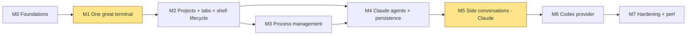

# DevDesk — Implementation Plan

Status: **Approved; implementing milestones with owner review.** M0–M4 are owner approved; M5–M7 proceed under the owner's autonomous implementation/validation/commit authorization (2026-10-08).

Sizing: **S** ≈ under a day, **M** ≈ 2–4 days, **L** ≈ 1–2 weeks of focused, Claude-assisted work with owner review. These are relative sizes for ordering and risk, not commitments.

## Guiding rules

1. **Every milestone ends in something you can use.** No milestone is pure infrastructure.
2. **The riskiest thing first:** a terminal good enough to host `claude` and `codex` (M1). If that fails, nothing else matters.
3. **Verify assumptions where they're cheapest.** Each ❓ from [technical-research.md §13](technical-research.md#13-assumptions-register) is an acceptance criterion in the earliest milestone that can test it.
4. **The owner reviews each milestone** against its acceptance list before the next starts. Code stays conventional (see the [user profile](#working-agreement)).

The highlighted milestones carry the highest technical risk. M3 and M4 could run in parallel, but sequential is recommended for one reviewer.

**MVP = M0–M6.** M7 is the hardening pass before relying on DevDesk daily.

---

## M0 — Foundations (S–M) — ✅ done, owner approved 2026-10-08

**Delivers:** an empty DevDesk window that builds reproducibly on this Mac.

| # | Task | Size | Depends |
|---|---|---|---|
| 0.1 | Install Rust stable via rustup (**needs owner OK**: machine change) | S | — |
| 0.2 | Try a CLT-only build of a gpui-component hello window with `runtime_shaders` (A1). If it fails: install Xcode + `xcodebuild -downloadComponent MetalToolchain` (**owner OK**) | S | 0.1 |
| 0.3 | Cargo workspace: `devdesk-term`, `devdesk-core`, `devdesk-app`. Exact pins for the `gpui-kit` facade and `alacritty_terminal`. Commit `Cargo.lock`. Record the compiling manifest + platform initialisation in technical-research | S | 0.2 |
| 0.4 | `scripts/check.sh`: `cargo fmt --check`, `clippy -D warnings`, `cargo test`, `cargo deny check licenses` (allowlist from ADR-020) | S | 0.3 |
| 0.5 | Window shell: sidebar placeholder + empty workspace, light/dark theme from gpui-component | S | 0.3 |
| 0.6 | Startup instrumentation: `DEVDESK_PERF=1` logs `t(main)` and `t(first frame)`. `scripts/perf/startup.sh` runs 10 cold starts and reports p50/p95 | S | 0.5 |
| 0.7 | `tracing` to `~/Library/Logs/DevDesk/devdesk.log` (size-capped) | S | 0.3 |

**Acceptance:**
- `cargo run -p devdesk-app` opens the window on this Mac. The toolchain decision (CLT-only vs Xcode) is recorded in technical-research.md.
- `scripts/check.sh` is green.
- Baseline cold start recorded (empty window).

**Migration review (2026-10-08):** 🧪 Rebuilt on the replacement M2 Max Mac; `scripts/check.sh` passes after owner-approved removal of AirDrop quarantine metadata from source/build paths. M0 measurements are preserved in `perf/baseline-m0.json`; the original machine's record is preserved in `perf/baseline-old-machine.json`. Owner approved M0 and requested its initial publication to a private `jringeisen/devdesk` GitHub repository. Memory and CPU budget misses remain recorded for the A11 investigation at the start of M1. See technical-research §10b.

**Risks:** GPUI build friction. Mitigation: 0.2 is a timeboxed spike (½ day) before anything else.

---

## M1 — One great terminal (L+, ≈2–3 weeks) ⚠️ highest risk

*Resized after adversarial review: IME, Unicode width, fallback fonts and mouse/focus encoders were missing.*

**Delivers:** a DevDesk window with one fully interactive login shell that can comfortably run `vim`, `htop`, `claude` and `codex`.

**First, before terminal implementation:** investigate A11 with the empty window: display-link/frame scheduling, cursor blink and sidebar behavior. Fix the idle overhead or document the upstream limitation. Use wakeup counter deltas over elapsed time; the default macOS `top` `IDLEW` values are cumulative, not rates (🧪 migration probe, technical-research §10b).

| # | Task | Size | Depends |
|---|---|---|---|
| 1.1 | `term::pty`: spawn an **explicit** `$SHELL -l` via alacritty `tty::new` (never the `/usr/bin/login` default), `EventLoop`, `TerminalHandle` | M | M0 |
| 1.2 | `EventProxy`: dirty-flag coalesced `Wakeup`. Answer `PtyWrite` (CPR/DA) and `ColorRequest` (OSC 10/11). Title, Bell, ChildExit. Deny OSC 52 *read* | M | 1.1 |
| 1.3 | `core::env`: resolve the login-shell env once (`$SHELL -l -i -c 'env -0'`, 3 s timeout, background thread). Fallback: the inherited env + a common PATH. Processes later spawn as `$SHELL -c` with this env (ADR-026). Test: `npm` and `php` both resolve | S | 1.1 |
| 1.4 | `term::snapshot`: lock → copy the visible region into `RenderSnapshot` (style-batched runs, merged background rects, cursor, selection) → unlock. Unit tests on batching | M | 1.1 |
| 1.5 | `TerminalElement` (app): cell metrics from the font, shape runs, paint backgrounds/text/cursor, only when visible | L | 1.4 |
| 1.6 | `term::keys`: GPUI-free `KeyInput` → bytes. Legacy xterm encoding, app-cursor/keypad modes, **kitty keyboard protocol** (flags from `Term` mode), Option-as-Meta setting. Table-driven tests. Adapted from the Apache-2.0 `alacritty` crate, with attribution | L | 1.1 |
| 1.7 | Resize: element bounds → rows/cols → `Msg::Resize` (debounced to one per frame) | S | 1.5 |
| 1.8 | Scrolling: wheel → scrollback. In alt-screen / mouse mode → mouse reports or arrow keys. Scrollback cap from config | M | 1.5 |
| 1.9 | Selection (mouse drag, double-click word, triple-click line), Cmd-C copy, Cmd-V paste with **bracketed paste** when enabled | M | 1.5 |
| 1.10 | Exit status line ("exited with 1 — ⏎ to restart"), bell indicator | S | 1.2 |
| 1.11 | Signal-disposition test (A7): child `trap -p` and `/bin/kill -l` show defaults. SIGINT reaches the child | S | 1.1 |
| 1.12 | **Text input via GPUI's input handler:** IME/preedit (marked text), dead keys and Option-accents (`⌥e e` → é), committed text → PTY | M | 1.6 |
| 1.13 | **Unicode correctness:** wide cells (CJK, emoji) occupy 2 cells even when shaping differs; fallback fonts for glyphs missing from the primary font; box-drawing and powerline glyphs aligned to the cell grid | M | 1.5 |
| 1.14 | **Mouse and focus reporting encoders:** SGR mouse (`?1006`) for click, drag and wheel; focus in/out (`?1004`) | S | 1.6 |
| 1.15 | **Recorded protocol fixtures:** capture `claude` and `codex` startup query/response bytes and key sequences into test fixtures, then replay them against `term` + `keys` in unit tests. These are regression tests that need no network or model | S | 1.2, 1.6 |
| 1.16 | Dirty-flag interleaving test: output arriving between snapshot and clear must still repaint (see architecture §5) | S | 1.4 |

**Acceptance (all must pass):**
- **Basics:** interactive zsh with your prompt, colours and `nvm`/`php` on PATH.
- **TUIs:** `vim`, `htop`, `less`, `git log` (pager) and `fzf` render and behave correctly. Resize reflows.
- **Agents:**
  - `claude` and `codex` start **without a visible stall** (TUI drawn under 1 s; no 250 ms probe timeout; verify with `codex` launch timing).
  - Shift+Enter inserts a newline in both.
- **Clipboard:** copy/paste works. Pasting multi-line text into `claude` does not submit early (bracketed paste).
- **Text and Unicode:** `⌥e e` types é; emoji and CJK align to the grid; Nerd Font/powerline prompts render.
- **Throughput:** `cat` of a 100 MB file finishes and the window stays responsive. Typing during the flood is echoed once output stops.
- **Bounded memory:** run `seq 1 2000000`; DevDesk memory plateaus.
- **Measured:** cold start (A2, including runtime shader compile), idle CPU with one idle shell, keystroke→echo latency, bytes per scrollback cell (A10). Record all in `perf/baseline.json`.

**Tests:** snapshot batching, key-encoding tables, a headless PTY integration test (`printf` → grid contents), the signal disposition test.

**Risk mitigation:**
- Key encoding and rendering are the bulk of the work. Use `gpui-terminal` (MIT/Apache) and `alacritty` (Apache) as readable references.
- If M1 runs past 2× its estimate, stop and review scope with the owner (e.g. defer mouse reporting).

---

**M1 implementation review (2026-10-08):** 🧪 The terminal implementation, protocol/stress tests and local performance harness are ready for [owner review](m1-review.md). 🧪 Owner approved the running M1 window on 2026-10-08 (“looks good lets continue”), authorizing M2. Owner requested committing M1 together with M2. A11 and A10 findings are in technical-research §10c/§10d.

## M2 — Projects, tabs, shell lifecycle (M–L)

**Delivers:** DevDesk replaces your terminal tabs. Multiple projects, multiple shells each, instant switching, clean shutdown.

| # | Task | Size | Depends |
|---|---|---|---|
| 2.1 | `core::config`: schema (architecture §8), validation with friendly errors (shown in-app, never a crash), `notify` watcher with debounce, hot reload of the project list | M | M1 |
| 2.2 | "Add Project…": folder picker → append to `config.toml` via `toml_edit` (comments preserved) | S | 2.1 |
| 2.3 | `core::supervisor`: actor thread, `Command`/`CoreEvent`, session registry (shells only), `Clock` trait for testable timers | M | M1 |
| 2.4 | `term::kill`: `killpg`, foreground group via `tcgetpgrp`, session sweep (❓ macOS `proc_listallpids` + `proc_pidinfo` to enumerate session members), escalation helper | M | 1.1 |
| 2.5 | UI mirror + sidebar (projects with expandable terminal list), tabs per project, new / close / rename terminal, status dot (running / exited) | M | 2.3 |
| 2.6 | Close-terminal confirmation when the foreground job isn't the shell ("vim is running") | S | 2.4 |
| 2.7 | Command palette (gpui-component): Switch Project, New Terminal, Close Terminal, Rename Terminal, Add Project. Keyboard: **Cmd-P** palette (Cmd-K stays "clear scrollback", matching Terminal.app/iTerm2; see open-questions I-4), Cmd-T new, Cmd-W close, Cmd-1…9 tabs, Cmd-Shift-[ / ] switch | M | 2.5 |
| 2.8 | Single-instance `flock`. Window close hides. Cmd-Q confirmation → parallel shutdown with 15 s deadline and a progress sheet | M | 2.3, 2.4 |

**Acceptance:**
- Three projects, ten terminals. Switching projects never kills a session. **Switch-to-frame under 50 ms** (instrumented).
- Closing a terminal that ran `sleep 1000 &; sleep 1000 &` leaves **no** survivors (`ps -s <sid>`).
- Cmd-Q with 10 busy terminals exits within the deadline, and no DevDesk children remain.
- Editing `config.toml` by hand updates the sidebar within 1 s. An invalid file shows an error banner and keeps the last good config.
- Palette opens in under 1 frame and supports fuzzy search.
- **Stress (moved earlier from M7):**
  - 10 terminals running `yes`, 3 visible: input in a quiet pane stays responsive and frame p95 stays under 33 ms.
  - Cmd-Q during that flood still exits within the deadline.

**Tests:** supervisor state tests with a fake clock; kill-tree integration tests (process group, background jobs, a process that ignores SIGHUP); config parse/validate unit tests.

---

**M2 implementation review (2026-10-08):** 🧪 Tasks 2.1–2.8, lifecycle integration tests and a bounded eleven-session stress probe are implemented. See [M2 review](m2-review.md) and the current `perf/baseline.json`. 🧪 Owner approved the running M2 window (“Looks good!”). Owner requested committing M1 and M2, then starting M3.

## M3 — Process management (M–L)

**Delivers:** Billi's `serve`, `horizon` and `vite` defined once in config, started together, visibly healthy or failed.

| # | Task | Size | Depends |
|---|---|---|---|
| 3.1 | `core::process`: ProcessSpec → spawn (`$SHELL -c` + resolved env, ADR-026), state machine (architecture §6), stop escalation (signal → SIGTERM → SIGKILL + sweep). `Stopped` only when the **session is empty** | M | M2 |
| 3.2 | Restart = stop, **await empty session**, start. Restart policy `on-failure` with exponential backoff (1 s → 30 s) and crash-loop give-up (5 failures in 60 s) | M | 3.1 |
| 3.2b | **Process identity vs instance (ADR-027):** one `Term` per configured process. Restart joins the old reader, resets modes via `Term`'s `Handler` methods (escape sequences can't do it: vte ignores DECSTR, RIS wipes the grid), writes a separator and attaches the new EventLoop to the same `Term`. Test: a crashed TUI in alt screen with mouse + kitty modes → restart → history intact, modes default | M | 3.2 |
| 3.3 | Sidebar process rows: status (Starting / Running / Stopping / Stopped / Failed with exit code), click to view its terminal, inline Start/Stop/Restart | M | 3.1 |
| 3.4 | Palette: Start All, Stop All, Start/Stop/Restart `<process>` (dynamic entries, e.g. "Restart Horizon") | S | 3.3 |
| 3.5 | Autostart on the first open of a project this run. "Config changed — restart to apply" marker | S | 3.1, 2.1 |
| 3.6 | **Session ledger** in SQLite (minimal `store` module; the table is created here), written at spawn **before** reporting Running. On launch: find live processes whose **sid** matches an entry, including when the leader is gone; verify with start times → "Kill / Leave" prompt. Self-`setsid` daemons are out of scope (documented) | M | 3.1 |

**Acceptance:**
- `Start All` brings up Billi's three processes. `Restart Horizon` from the palette works.
- `artisan serve` restart never hits "Address already in use". This includes a test where the leader exits while a SIGTERM-ignoring child still holds the port: restart waits, escalates and only then starts.
- After Horizon crashes and auto-restarts, its crash output is still visible above a "restarted after exit N" separator.
- `npm run dev` works as a configured process (nvm PATH).
- `kill -9` of `php artisan horizon` from outside → Failed (red) → restarted per policy. A crash loop stops after 5 failures in 60 s.
- Force-quitting DevDesk (`kill -9`) and relaunching → survivors detected and killable. A PID reused by an unrelated process is **not** offered.
- Typing into a process terminal works (`artisan tinker` as a process).

**Tests:** state machine unit tests covering every transition in the diagram (fake clock); restart/backoff tests; integration test with a script that traps SIGINT and exits slowly (verify escalation timing); PID-reuse guard test.

---

**M3 implementation review (2026-10-08):** 🧪 Tasks 3.1–3.6 and lifecycle/recovery tests are implemented; [M3 review](m3-review.md) records coverage and the remaining owner acceptance. The owner's ai-crm commands are configured for manual start. 🧪 Owner confirmed the process-tab fix and requested committing M3, then continuing to M4. Recorded performance limitations remain open.

## M4 — Claude agents, persistence, restore (L)

**Delivers:** launch, watch, stop and resume Claude agents per project, with live status. DevDesk remembers your layout.

| # | Task | Size | Depends |
|---|---|---|---|
| 4.1 | `core::store`: SQLite (bundled, WAL), `user_version` migrations, `agents` + `ui_state` tables | M | M3 (3.6) |
| 4.2 | `core::ipc`: Unix socket in a 0700 `run/` dir, socket 0600. Listener with a 250 ms per-connection read deadline, ≤16 concurrent connections, 64 KiB cap, per-agent rate limit, schema validation, `LaunchId` + token check. Tests: slowloris client, oversized message, stale `LaunchId` | M | M2 |
| 4.3 | Hook helper: `DevDesk hook <kind>` dispatched **before** GPUI init. **Two transports:** stdin (Claude hooks) and last-argv JSON (Codex notify). Extract status fields before truncating. 200 ms connect+write deadline, always exit 0, no stdout. Measure under 10 ms with `hyperfine` | S | 4.2 |
| 4.4 | `core::agent`: `AgentProvider` trait, `ClaudeProvider` (New / Resume / ResumePicker), golden argv tests, `check_installed` + version check | M | 4.1 |
| 4.5 | Agent status machine (architecture §7) driven by hook signals + exit, including PostToolUseFailure, PermissionDenied and StopFailure. Scenario tests: approve-then-fail, deny, API failure, parallel tools, a blocked Stop | M | 4.2, 4.4 |
| 4.5b | `LaunchProfile` derived from the record's role on every path (new, resume, picker, restore). Golden test: a Side record never yields Primary argv | S | 4.4 |
| 4.6 | UI: sidebar Agents section (per project, status dots: working / idle / **needs approval**), Launch Claude, Stop, Rename. Dock badge = number of agents needing approval | M | 4.5 |
| 4.7 | Restore (ADR-013): save layout on change (debounced), restore on launch, Resume stubs for agents. A shell tab's cwd is read from the shell pid (`proc_pidinfo` `PROC_PIDVNODEPATHINFO`), or from OSC 7 if the shell emits it | M | 4.1 |
| 4.8 | `scripts/cli-probe.sh`: fork-while-running, enforcement and hook probes from technical-research Appendix A, as one script with PASS/FAIL output | S | 4.4 |
| 4.9 | Probe A5: user-level probe hook still fires when DevDesk injects `--settings` hooks | S | 4.4 |

**Acceptance:**
- "Launch Claude" in Billi opens a pane. The status dot goes idle → working (on prompt) → **needs approval** (on a permission prompt) → working → idle.
- Quit and relaunch → the same layout; the agent tab is a stub; Resume continues **the same conversation**.
- "Resume other Claude session…" → pick a session in the CLI picker → it becomes a tracked record.
- The hook helper adds under 10 ms per event. Killing DevDesk mid-session doesn't hang the agent's hooks.
- A5 confirmed, or mitigated and documented.

**M4 implementation review (2026-10-08):** 🧪 Tasks 4.1–4.9 are implemented; [M4 review](m4-review.md) records automated evidence and the pending owner checklist. Claude 2.1.295 settings merge, running fork and same-session resume probes pass. Warmed release helper timing meets 10 ms; first invocation and first app launch miss their budgets. 🧪 Owner approved M4 (“M4 looks good”) and authorized autonomous validation, commits and continuation through M5–M7 while unavailable. Individual manual coverage limits and performance misses remain recorded.

---

## M5 — Side conversations: Claude (M) ⚠️ key differentiator

**Delivers:** ask a running Claude agent "why did you…?" in a split pane, without interrupting it.

| # | Task | Size | Depends |
|---|---|---|---|
| 5.1 | **First: interactive enforcement test (A3).** Launch the hardened fork argv (agent-integration §5.3) in a DevDesk pane and ask it to Edit, Write and run Bash. All are rejected and the file is unchanged. Automate it via a headless `devdesk-term` PTY in an integration test (gated behind `--ignored`, since it costs tokens). **If it fails:** switch to the headless-fork fallback (ADR-008) before continuing | S | M4 |
| 5.2 | `LaunchRequest::Fork` for Claude + golden tests. Fork session ID from `SessionStart(source=fork)` | S | 5.1 |
| 5.3 | "Ask Agent Question" (Cmd-Shift-A / palette): one-line question input → split pane (gpui-component `resizable`) → launch with observer preamble + question | M | 5.2 |
| 5.4 | Side-pane chrome: "Read-only · snapshot at 14:32 · of <parent>". Esc/Cmd-W closes and stops it. Listed under the parent in the sidebar history | S | 5.3 |
| 5.5 | Confirm/disallow residual account tools (R9) and document what remains | S | 5.1 |

**Acceptance:**
- While the parent runs a multi-minute task, ask "Why did you introduce X instead of Y?" The answer reflects the parent's actual reasoning, and the parent's output and hook events continue throughout.
- The side answer doesn't claim the parent stopped (preamble effective in at least 4 of 5 trials).
- Asking the side pane to edit a file → refused by the tool layer; the file is unchanged (`git status` clean).
- Closing the side pane leaves no process behind.

**M5 implementation review (2026-10-08):** 🧪 Tasks 5.1–5.5 implemented and autonomously validated under the owner's authorization. Five interactive Claude forks pass enforcement and inherited-reasoning checks while a two-minute parent completes; supervisor and native split probes pass. See [M5 review](m5-review.md). Account-registry/model-inheritance coverage limits and the first-launch budget miss are recorded explicitly.

---

## M6 — Codex provider (M) — ✅ implemented and validated 2026-10-09

**Delivers:** everything from M4–M5 for Codex. This validates the provider abstraction against a second real CLI.

| # | Task | Size | Depends |
|---|---|---|---|
| 6.0 | **½-day spike: app-server status.** A DevDesk-owned `codex app-server --listen unix://…` + TUI `--remote`. If `thread/status/changed` is reliable and the lifecycle stays DevDesk-owned, prefer it over 6.2's heuristics | S | M5 |
| 6.1 | `CodexProvider`: `--no-daemon` everywhere, `-c notify` → helper (argv transport; chains the unchanged payload to the user's own notify if set), `tui.notifications` / BEL, golden argv tests | M | 6.0 |
| 6.2 | Status: notify → Idle + thread ID; Bell → **Attention**; Enter → **Active (inferred)** (10-minute no-output decay); exit → Exited. Exit-summary thread-ID fallback. Scenario tests: menus, Esc-cancel, failed turn, a command printing BEL | M | 6.1 |
| 6.3 | Fork side conversation: `codex fork <id> --no-daemon -s read-only -a never` + **every configured MCP server disabled + action features disabled** (agent-integration §5.4), failing closed if the config can't be read. **First: interactive enforcement tests (A4):** shell write fails; `apply_patch` rejected; no `mcp__*` tools; `collaboration.*` can't reach the parent | M | 6.1 |
| 6.4 | Verify stop semantics **in DevDesk's own process tree**: give the agent a deterministic continuing workload (`sleep 20 && touch marker`), Stop it, and confirm the session is empty and `marker` never appears. (`codex agents` only shows the shared daemon, so it proves nothing for `--no-daemon`) | S | 6.1 |
| 6.5 | Review the `AgentProvider` trait against both implementations. Simplify anything Codex didn't need | S | 6.2 |

**Acceptance:** same as M4 and M5, using Codex, plus:
- Stopping a Codex agent mid-turn really stops the work (verified by the 6.4 marker test and an empty session).
- A Codex side conversation has no `mcp__*` tools, even though the user's config enables `node_repl`.
- A6 confirmed: `-c` overrides apply in the interactive TUI.
- The side conversation's `touch` fails with `Operation not permitted` in the pane.

---

🧪 M6 review: [automated acceptance, CLI findings and limits](m6-review.md). Five interactive read-only forks, same-fork Resume, parent completion and actual workload Stop pass; 65 offline tests pass. Startup median passes; first/p95 remains over 500 ms. Owner-authorized autonomous commit; no absent-owner visual sign-off is claimed.

## M7 — Hardening and performance (M)

**Delivers:** confidence to use DevDesk all day.

| # | Task | Size |
|---|---|---|
| 7.1 | 20-terminal benchmark (`yes` in 20 panes, 3 visible; the 10-terminal version already ran in M2). Frame p95, input latency, thread count (A8). Decide whether a shared reader is needed | M |
| 7.2 | Memory budget validation: baseline, +20 idle shells, +20 full scrollbacks. Tune the default `scrollback_lines` | S |
| 7.3 | Idle CPU and wakeups (`powermetrics --samplers tasks`) with 20 idle sessions: zero DevDesk timer wakeups | S |
| 7.4 | Panic hook: log + attempt graceful child shutdown. Crash-relaunch path tested | S |
| 7.5 | Unsigned `.app` bundle script (stable helper path for hooks; `Info.plist`; icon) | S |
| 7.6 | Commit `perf/baseline.json` and the comparison script | S |
| 7.7 | Keyboard-only pass: every action reachable without a mouse | S |

---

## MVP feature set (M0–M6)

**In:**
- Projects from TOML with a sidebar and add-via-folder-picker.
- Multiple shell terminals per project: tabs, rename, status, scrollback, copy/paste, kitty keyboard, resize.
- Configured processes: start/stop/restart/all, graceful → forced stop, restart-on-failure, autostart on project open, failure indicators, orphan recovery.
- Claude and Codex agents: launch, status (working / idle / needs approval / exited), stop, resume, resume picker.
- Read-only side conversations via native fork, in a split pane.
- Command palette; window restore with agent resume stubs; Cmd-Q graceful stop-all.

**Out (by decision):** daemon / processes surviving quit, per-repo config, secret store, output log files, worktree management, native chat UI, transcript parsing, multiple windows, readiness probes, notarisation, Linux, plus everything in the brief's exclusion list.

---

## Testing strategy

| Layer | What | Where | When |
|---|---|---|---|
| Unit | Provider golden argv; agent & process state machines (every transition, fake `Clock`); restart backoff; config validation; key-encoding tables; snapshot batching | `devdesk-term`, `devdesk-core` | Every `scripts/check.sh` |
| Headless integration | Real PTYs, no GPUI: grid contents after output; process-group and session kill (including background jobs and SIGHUP-ignorers); stop escalation timing; signal dispositions; PID-reuse guard; IPC socket robustness (malformed, oversized, unknown agent) | `devdesk-core/tests`, `devdesk-term/tests` | Every check |
| Supervisor determinism | Fake clock + scripted child exits → assert event sequences (race table in architecture §5) | `devdesk-core` | Every check |
| UI logic | Keep views thin. `gpui-kit`'s `test-support` feature (GPUI test harness + UI helpers, verified to exist in M0) for palette filtering and mirror updates | `devdesk-app` | Every check |
| External CLI contract | `scripts/cli-probe.sh`: fork-while-running, read-only enforcement (both CLIs), hook/notify payload shape, `--no-daemon` stop semantics | Manual script (costs tokens) | **Whenever `claude` or `codex` updates**, and before each milestone sign-off |
| Agent TUI automation | Drive `claude`/`codex` in a headless `devdesk-term` PTY (enforcement tests) | `#[ignore]` integration tests | On demand |
| Manual matrix | vim, nvim, htop, less, fzf, git pager, tmux, artisan tinker, npm run dev, docker compose up, claude, codex | Checklist in each milestone PR | Milestone sign-off |

## Performance budgets and benchmarking

Every measurement reports **three separate numbers**: (1) DevDesk's own process (`phys_footprint`, CPU), (2) the sum over managed child process trees, (3) the agent CLI processes. Only (1) is DevDesk's budget.

| Metric | Budget | Method |
|---|---|---|
| Cold start → first frame | **< 500 ms** p50 (10 runs) | `scripts/perf/startup.sh` + `DEVDESK_PERF` timestamps |
| Idle memory, no terminals | < 60 MB | `footprint <pid>` |
| Idle memory, 20 idle shells (empty scrollback) | **< 100 MB** | same |
| Scrollback memory | 🧪 inline floor: lines × cols × 24 B/cell; 5,000 × 120 ≈ **14.4 MB**. Headless measured ~19.1 MB plain/styled; all-combining ~77 MB | M1 measured; metadata/allocator add to the floor (technical-research §10d) |
| Idle CPU (20 idle sessions) | **< 0.3 %** avg over 60 s; **0** DevDesk timer wakeups | `top -l`, `powermetrics --samplers tasks` |
| Project switch | **< 50 ms** to presented frame (aim: 1 frame) | Instrumented action → frame timestamp |
| Keystroke → PTY write | < 2 ms p99 | Instrumented |
| Keystroke → echo painted | < 16 ms p95 added by DevDesk | Instrumented, echo-mode test (`cat`) |
| Output flood (`cat` 100 MB) | Completes within 1.5× Alacritty's time; other visible panes keep frame p95 under 16 ms | `scripts/perf/flood.sh` |
| 20 concurrent noisy terminals | UI frame p95 < 33 ms; input stays responsive | `scripts/perf/many.sh` (M7) |
| Hook helper | < 10 ms per invocation | `hyperfine` |

**Note on memory:**
- Bytes per cell is a floor, not a bound. alacritty's `CellExtra` grows with combining characters and hyperlinks ✅. M1 measures adversarial output (heavy styling, combining marks, OSC 8 links) as well as plain text, and caps per-cell metadata if needed.
- "< 100 MB idle" is achievable only with **empty or modest** scrollback. Twenty terminals with full 5,000-line scrollback at 120 columns have an inline floor around 288 MB, before allocator/metadata (🧪 A10 cell size; total remains a multi-session estimate). This is user-controlled memory, not overhead. The perf report shows it separately.

**Regression process:**
- `scripts/perf/run.sh` writes JSON; `perf/baseline.json` is committed in M1 and updated deliberately.
- A milestone can't be signed off if a metric regresses more than 15% against baseline without an explanation.
- Criterion micro-benchmarks for `snapshot` building, key encoding and headless parse throughput run via `cargo bench`.

## Risk register (plan-level)

| Risk | Milestone | Mitigation |
|---|---|---|
| GPUI build or toolchain friction | M0 | ½-day timeboxed spike; Xcode fallback |
| Terminal correctness and key encoding take longer than planned | M1 | Permissive references; scope review at 2× estimate |
| gpui-component lacks a needed widget (A9) | M2 | Build that one widget by hand; it doesn't change the architecture |
| Process tree kill misses descendants | M2–M3 | Session sweep + integration tests with nasty process trees |
| Interactive-mode read-only enforcement fails | M5/M6 | Fallback: headless fork (verified) |
| CLI updates break flags or hooks | M4+ | Golden tests + `cli-probe.sh` on every update |
| gpui-pre upgrade breaks the build | Any | Upgrade only between milestones, in a dedicated commit |

## Working agreement

- Claude implements; the owner reviews. Code is idiomatic and plain: `Arc<FairMutex<…>>` only where the architecture says so, message passing elsewhere, no macros or generics beyond what libraries require.
- Each milestone lands as a series of small reviewable commits, each with tests.
- Ownership and concurrency choices are explained in doc comments where they aren't obvious.
